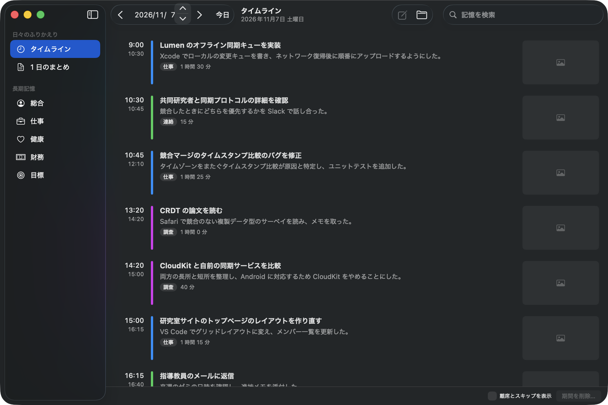
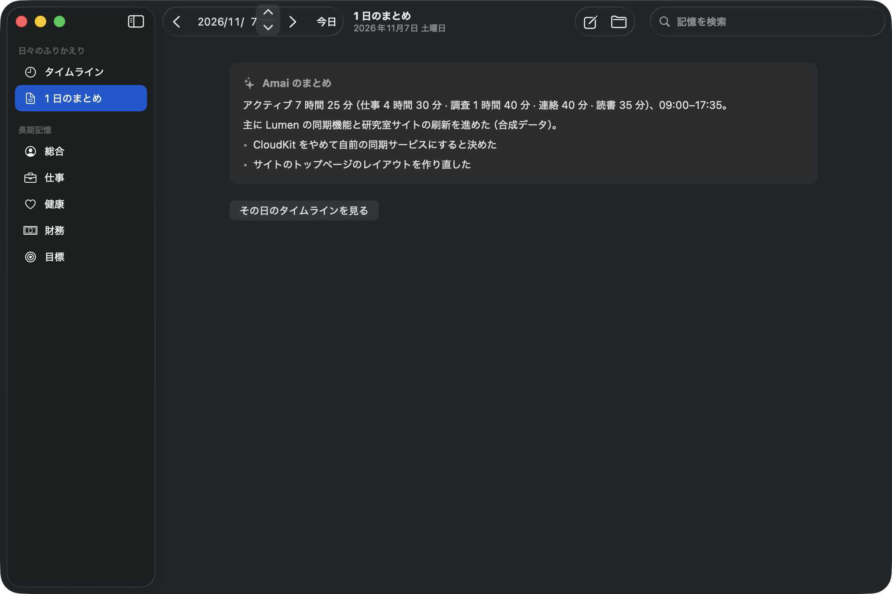
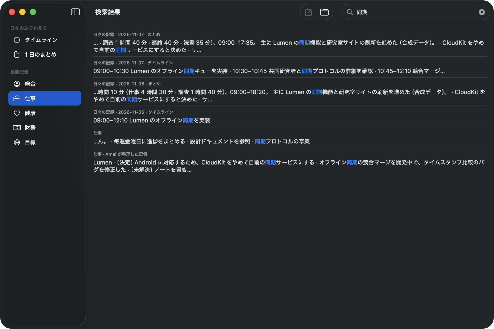
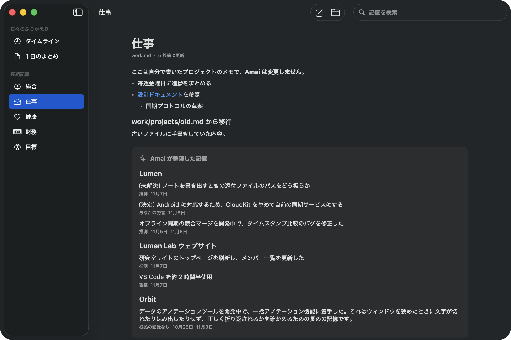
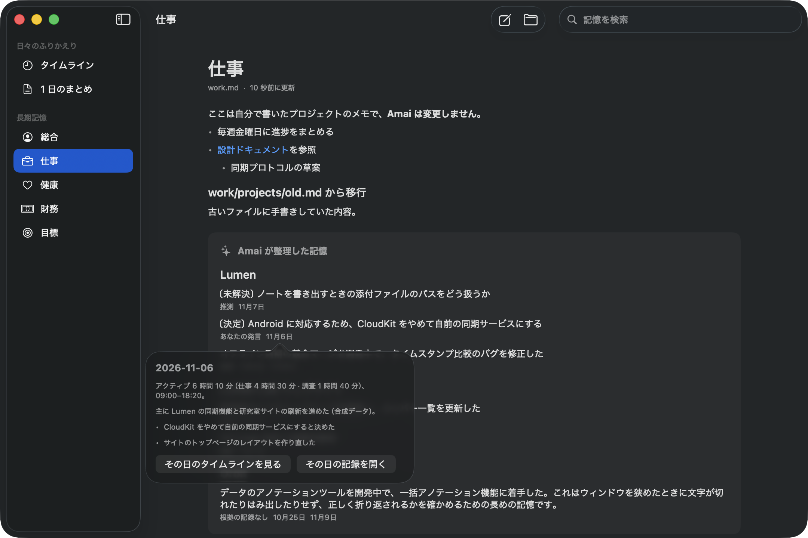
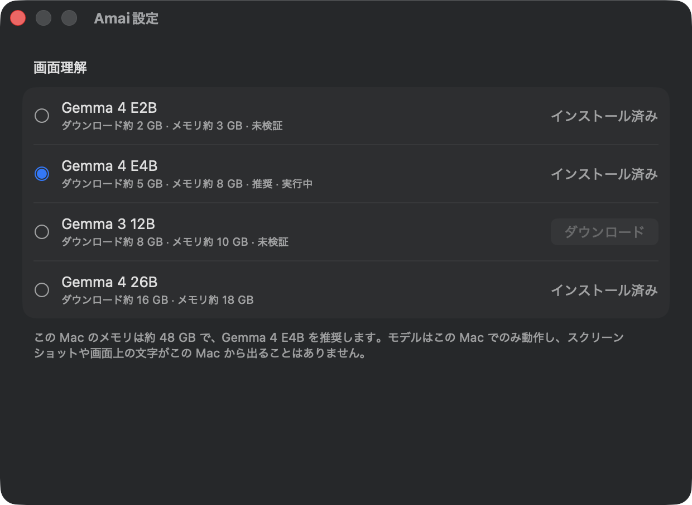
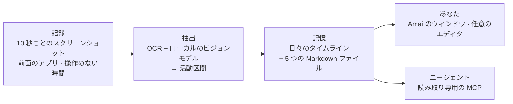

<div align="center">

# Amai

**macOS のための Ambient Personal AI**

Amai は Mac での作業をバックグラウンドで記録し、日々のタイムラインと長期記憶に整理します。<br>
記憶はこの Mac 上のプレーンな Markdown で、AI エージェントからも参照できます。

[](https://github.com/Penrose0v0/Amai/releases/latest)
[](#動作環境)
[](#動作環境)
[](Package.swift)
[](docs/mcp.md)
[](LICENSE)

[English](README.md) · [简体中文](README.zh-CN.md) · **日本語**



<sub>スクリーンショットは <a href="samples/">samples/</a> の合成サンプルデータで、実在の人物の活動ではありません。</sub>

</div>

---

## クイックスタート

```bash
brew install --cask Penrose0v0/tap/amai
```

[GitHub Releases](https://github.com/Penrose0v0/Amai/releases/latest) から zip をダウンロードすることもできます。Apple Silicon 搭載の Mac と macOS 15 以降が必要です。詳しくは[インストール](#インストール)を参照してください。

## Amai が選ばれる理由

多くの AI アシスタントは、入力された内容しか知りません。Amai はその文脈をバックグラウンドで代わりに蓄積し、あなたの手元に置いておきます。

| | |
|---|---|
| 🌙 **アンビエント** | 日記もプロンプトも不要です。Amai が画面を見て、タイムラインを自分で書きます。 |
| 🔒 **ローカルファースト** | スクリーンショットは Mac 上で動くビジョンモデルが理解し、外部に送られることはありません。 |
| 📝 **プレーンな Markdown** | 記憶は `~/.amai/memory` にファイルとして保存され、どんなツールでも開いて編集・バックアップできます。 |
| 🔍 **根拠をたどれる** | 記憶の各項目に、あなたの発言・観察・推測のどれに基づくかが記録されます。 |
| 🤖 **エージェント対応** | 読み取り専用の MCP サーバーにより、許可した範囲で Claude Desktop や Claude Code などのエージェントが記憶を検索できます。 |

## 機能

以下は **v0.1.0** で利用できる機能です。

### タイムラインと 1 日のまとめ

約 15 分ごとの画面の活動が、タイトル・要約・カテゴリ・所要時間を持つタイムラインの項目になります。夜のあいだに、Amai が前日の短いまとめを書きます。どちらも `daily/YYYY-MM-DD.md` に保存されます。

<table>
  <tr>
    <td width="50%"></td>
    <td width="50%"></td>
  </tr>
  <tr>
    <td align="center"><sub>1 日のまとめ</sub></td>
    <td align="center"><sub>タイムラインと記憶をまとめて検索</sub></td>
  </tr>
</table>

### 長期記憶

Amai は日々の記録から、**総合**・**仕事**・**健康**・**財務**・**目標**の 5 つの分野の記憶を更新します。分野ごとに 1 つの Markdown ファイルです。

- Amai が書き込むのは、自分用に区切られたブロックの中だけです。ファイルにあなたが書いた内容は変更されません。
- 各項目には根拠（*あなたの発言*・*確認済み*・*観察*・*推測*）と、元になった日付が表示されます。日付をクリックすると、その日のタイムラインに移動します。
- 置き換えや取り下げになった項目は変更履歴に残り、書き換えの前には毎回スナップショットが保存されます。
- 別のエディタで編集した内容も、数秒でアプリに反映されます。

<table>
  <tr>
    <td width="50%"></td>
    <td width="50%"></td>
  </tr>
  <tr>
    <td align="center"><sub>プロジェクトごとに整理された仕事の記憶</sub></td>
    <td align="center"><sub>各項目から元の日にさかのぼれる</sub></td>
  </tr>
</table>

### デバイス上のモデル

画面の理解は、常に [MLX](https://github.com/ml-explore/mlx-swift) 上の Gemma ビジョンモデルでローカルに行います。モデルは設定から選んでダウンロードします。Amai は一日中動き続けるため、この Mac のメモリの 3 分の 1 以下で動く、検証済みの最大のモデルを推奨します。

| モデル | ダウンロード | メモリ | 状態 |
|---|---|---|---|
| Gemma 4 E4B | 約 5 GB | 約 8 GB | デフォルト · 検証済み · メモリ 24 GB 以上で推奨 |
| Gemma 4 26B | 約 16 GB | 約 18 GB | 検証済み · メモリ 64 GB 以上で推奨 |
| Gemma 4 E2B | 約 2 GB | 約 3 GB | 未検証 · メモリの少ない Mac 向け |
| Gemma 3 12B | 約 8 GB | 約 10 GB | 未検証 |

<p align="center"></p>

長期記憶の整理に使うモデルは、初回セットアップで選びます。ローカルモデル、自分の Anthropic または OpenAI の API キー、ChatGPT サブスクリプション（公式の *Sign in with ChatGPT*）、ログイン済みの Claude Code を通じた Claude サブスクリプションから選べます。クラウドを選んだ場合も、送信されるのは記憶のテキストだけで、スクリーンショットは送信されません。

### そのほか

- **初回セットアップ**：言語、記録される内容、画面収録の許可、モデルの選択を案内します。セットアップが終わるまで何も記録されません。
- **メニューバーアプリ**：いつでも記録を一時停止・再開でき、アイコンで現在の状態がわかります。
- **複数ディスプレイ**：すべてのディスプレイを記録し、作業中のディスプレイを最も重視します。
- **3 つの表示言語**（简体中文・English・日本語）。表示言語は、記憶を書く言語とは別に設定できます。

## しくみ



1. **記録**：10 秒ごと（バッテリー駆動時はより長い間隔）にすべてのディスプレイのスクリーンショットを撮り、前面のアプリと操作のない時間を記録します。スクリーンショットはコンパクトな HEVC 動画として短期バッファに保存されます。
2. **抽出**：各フレームを Apple Vision の OCR とローカルのビジョンモデルで読み取り、*見えたもの*と*推測したもの*を分けて記録します。そのうえでフレームを活動にまとめます。
3. **記憶**：活動をその日の daily ファイルに書き込みます。午前 4 時ごろに前日をまとめ、長期記憶の各分野を更新します。総合は週に 1 回更新されます。

詳しくは[アーキテクチャ](docs/architecture.md)と[記憶システム](docs/memory.md)を参照してください。

## プライバシー

Amai は画面を見るアプリなので、プライバシーは後から付けた設定ではなく、設計の一部です。

- **スクリーンショットは Mac の外に出ません。** ビジョンモデルはローカルで動き、モデルのダウンロード時に接続するのは Hugging Face だけです。
- **元のスクリーンショットは一時的です。** 最長 72 時間または 2 GB のどちらかに達した時点で削除されます。
- **機密性の高い場面はスキップします。** パスワード欄への入力中や、パスワード管理アプリ（1Password、Bitwarden、KeePassXC、キーチェーンアクセス）が前面にあるあいだは記録しません。除外が確実に効いていることを確認できない場合、そのフレームは破棄します。
- **キー入力は記録しません。** 記録するのはアプリの切り替えと操作のない時間だけです。
- **認証情報はマスクされます。** OCR のテキストは保存前にマスクされ、ログには件数と所要時間だけが残り、画面の内容は残りません。
- **クラウドの利用は任意です。** 記憶の整理がクラウドに送られるのは、クラウドを選んだ場合だけで、そのときも送信されるのは記憶のテキストだけです。
- **すべて確認・削除できます。** タイムラインから任意の期間を削除でき、Markdown ファイルは自由に編集・削除でき、メニューバーからいつでも一時停止できます。

## AI エージェントとの連携（MCP）

Amai には読み取り専用の MCP サーバー `amai-mcp` が同梱されており、**初期状態ではオフ**です。オンにすると、次の 3 つのツールを提供します。

| ツール | 返す内容 |
|---|---|
| `search_memory` | 一致した記憶の項目（分野、日付、根拠の種類つき） |
| `get_timeline` | 指定した日の活動と 1 日のまとめ（`today`、`yesterday` または日付） |
| `get_memory` | 1 つの分野の記憶。特定のセクションやプロジェクトだけを取得することも可能 |

`~/Library/Application Support/Amai/config.json` でオンにし、エージェントに読ませる分野を選びます。初期状態で読めるのは `general`、`work`、`goals` だけで、`daily`、`health`、`finance` は追加するまで閉じたままです。

```json
"mcp": { "enabled": true, "categories": ["general", "work", "goals"] }
```

そのうえでエージェントに追加します。

```bash
# Claude Code
claude mcp add amai -- /Applications/Amai.app/Contents/MacOS/amai-mcp
```

```jsonc
// Claude Desktop: ~/Library/Application Support/Claude/claude_desktop_config.json
{ "mcpServers": { "amai": { "command": "/Applications/Amai.app/Contents/MacOS/amai-mcp" } } }
```

このサーバーは記憶に書き込まず、ネットワークにも接続しません。ただし、エージェントが読んだ内容はそのエージェントが使うモデルのサービスに送られるため、共有してもよい分野だけを開いてください。詳しくは [docs/mcp.md](docs/mcp.md)（中国語）を参照してください。

## 使い方の例

- **「今週、実際に何をしたっけ？」** 記憶をたどる代わりに、タイムラインと 1 日のまとめを見返せます。
- **前回の続きから再開する。** プロジェクトの記憶には決定事項・未解決の課題・進捗が残り、それぞれ元の日にさかのぼれます。
- **エージェントに本当の文脈を渡す。** 回答の前に、Claude があなたの今のプロジェクトや目標を参照できます。自分で貼り付ける必要はありません。
- **自分の履歴を自分で持つ。** すべてはディスク上の Markdown です。grep するのも、バージョン管理するのも、好きな方法で同期するのも自由です。

## インストール

### Homebrew（推奨）

```bash
brew install --cask Penrose0v0/tap/amai
```

### 手動でダウンロード

[GitHub Releases](https://github.com/Penrose0v0/Amai/releases/latest) から `Amai-<バージョン>.zip` をダウンロードして展開し、`Amai.app` を `/Applications` に移動してから、次のコマンドを実行します。

```bash
xattr -dr com.apple.quarantine /Applications/Amai.app
```

Amai は署名済みですが、**まだ公証（notarization）されていません**。Homebrew の cask は隔離属性を自動で取り除きます。手動でダウンロードした場合は上のコマンドが必要です。

### 動作環境

- Apple Silicon 搭載の Mac、macOS 15 Sequoia 以降
- デフォルトのモデル（Gemma 4 E4B）にはメモリ 24 GB 以上。メモリの少ない Mac では Gemma 4 E2B を使えます
- モデル用のディスク容量（Gemma 4 E4B で約 5 GB、初回にダウンロード）と、最大 2 GB のスクリーンショット用短期バッファ

### 初回起動

Amai はメニューバーに常駐します。一度開くと初回セットアップが始まり、画面収録の許可を求め、モデルの選択とダウンロードを案内します。最後に**記録を開始**をクリックするまで記録は始まりません。

### データの保存場所

| 場所 | 内容 |
|---|---|
| `~/.amai/memory/` | 記憶（Markdown）。場所は変更できます。 |
| `~/Library/Application Support/Amai/` | 設定、スクリーンショットの短期バッファ、抽出結果、スナップショット |

`brew uninstall --cask amai` でアプリは削除されます。記憶のファイルは、`brew uninstall --zap` でも削除されません。

## 現状とロードマップ

Amai は **v0.1.0**、作者自身が毎日使いながら開発している初期リリースです。粗い部分もあります。

**既知の制限**

- まだ公証されていません。
- 記録中に Amai が終了すると、直前の数秒分の画面の動画が失われることがあります。
- ローカルモデルで整理した記憶は、大規模なクラウドモデルより品質が下がります。特に健康と財務で顕著です。[評価の記録](docs/roadmap.md)（中国語）を参照してください。

**予定（v0.1.0 には含まれません）**

- システム音声とマイクの文字起こし
- 設定ウィンドウでの MCP のオン／オフと公開する分野の選択
- 公証
- 意味検索（embedding）と、記憶をもとにした対話型の質問応答

詳細と進捗は [docs/roadmap.md](docs/roadmap.md)（中国語）にあります。

## 開発

macOS 15 以降、Xcode 26（Metal ツールチェーンのコンポーネントを含む）、Swift 6 が必要です。

```bash
swift build                  # ビルド
swift test                   # MLX のモデルの重みを必要としないテスト
./scripts/bundle.sh          # .build/Amai.app を組み立てる（mlx.metallib を含め、署名する）
open .build/Amai.app         # 実行（メニューバーアプリ）
./scripts/memory-preview.sh  # 合成サンプルデータだけでメインウィンドウを開く
```

SwiftPM は Metal カーネルをコンパイルしないため、`swift run` では MLX の推論を実行できません。`bundle.sh` を使ってください。

`bundle.sh` は、「Apple Development」証明書があればそれで署名するため、再ビルドしても画面収録やキーチェーンの許可が保たれます。証明書がない場合は、`./scripts/setup-dev-cert.sh` で作成する自己署名証明書 `Amai Local Dev` を使います。`AMAI_SIGN_IDENTITY` で別の署名 ID を指定することもできます。リリース用のパッケージングについては [docs/release.md](docs/release.md) を参照してください。

### アーキテクチャ

Amai は、**記録 → 抽出 → 記憶**の 3 層を厳密に分けた Swift パッケージです。

```text
Sources/
├── AmaiCore/         データ契約（PerceptionEvent、Observation、ActivitySegment、MemoryEntry）、時計、ログ
├── AmaiPerception/   画面と操作の記録、アクセス許可、元データのバッファ、プライバシーポリシー
├── AmaiExtraction/   OCR、ローカルモデル（mlx-swift-lm）、バッチ処理、活動の区切り
├── AmaiMemory/       Markdown の保存、整理、インデックス（GRDB / SQLite FTS5）、読み取り専用の Memory API
├── AmaiMemoryUI/     タイムラインと記憶ブラウザの画面
├── AmaiCloud/        記憶の整理に使う任意のクラウド／サブスクリプションのクライアント
├── AmaiMCP/          Memory API の上に構築した MCP ツール
├── AmaiMCPServer/    amai-mcp の実行ファイル（stdio）
├── AmaiMemoryCLI/    開発用 CLI amai-memory
└── Amai/             メニューバーアプリ、設定、初回セットアップ、各層の組み立て
```

| ドキュメント | 内容 |
|---|---|
| [docs/product.md](docs/product.md) | プロダクトの定義と範囲 |
| [docs/architecture.md](docs/architecture.md) | 層、モジュール、データ契約 |
| [docs/memory.md](docs/memory.md) | Markdown の記憶の形式と整理のしくみ |
| [docs/mcp.md](docs/mcp.md) | MCP サーバーの設定 |
| [docs/release.md](docs/release.md) | パッケージングと配布 |
| [docs/decisions/](docs/decisions/) | アーキテクチャ決定記録 |
| [AGENTS.md](AGENTS.md) | コントリビューターとコーディングエージェント向けのエンジニアリング方針 |

プロジェクトのドキュメントは現在、中国語で書かれています。

## 謝辞

Amai の設計は、[Dayflow](https://github.com/JerryZLiu/Dayflow)、[Screenpipe](https://github.com/mediar-ai/screenpipe)、[OpenClaw](https://github.com/openclaw/openclaw)、[Hermes Agent](https://github.com/NousResearch/hermes-agent) などのオープンソースプロジェクトから着想を得ています。

これらのプロジェクトとコントリビューターの皆さんに、オープンソースのエコシステムを支えてくださっていることへの感謝を申し上げます。

## ライセンス

[MIT](LICENSE)
