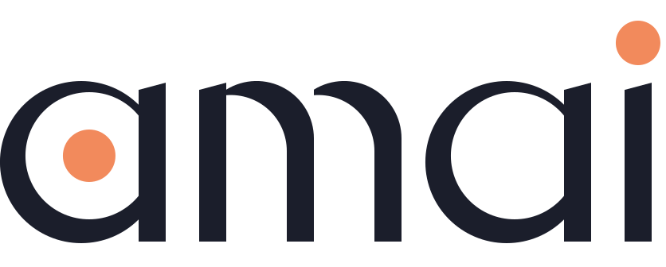
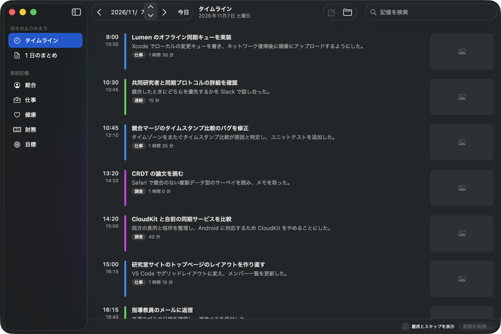
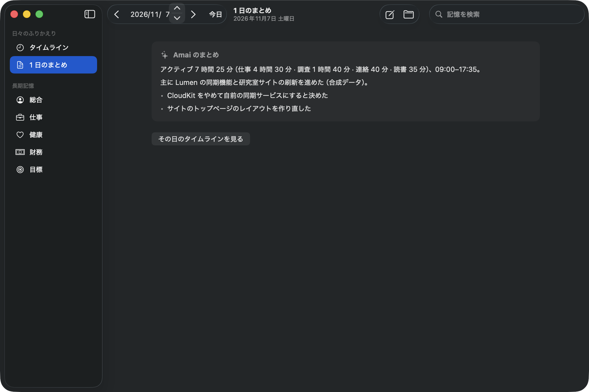
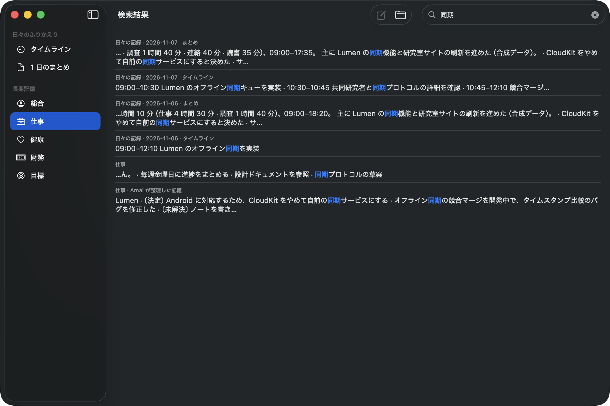
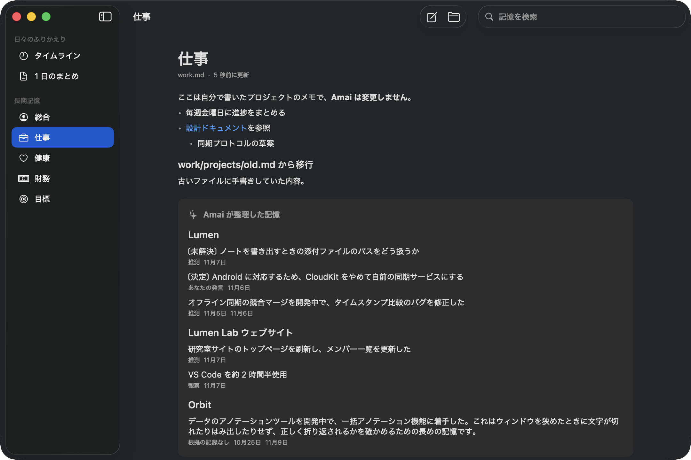
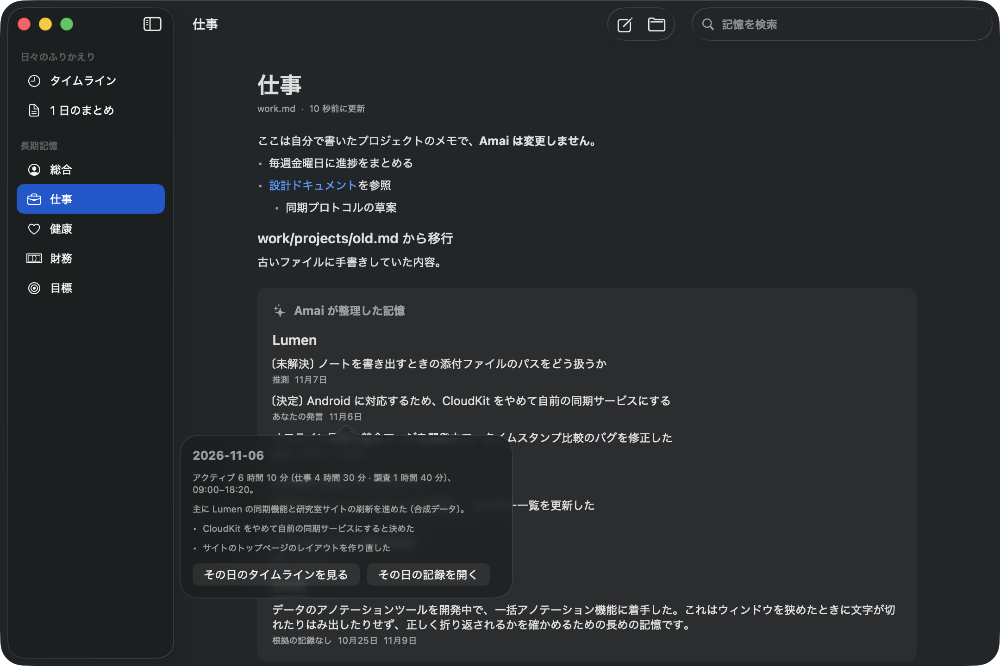
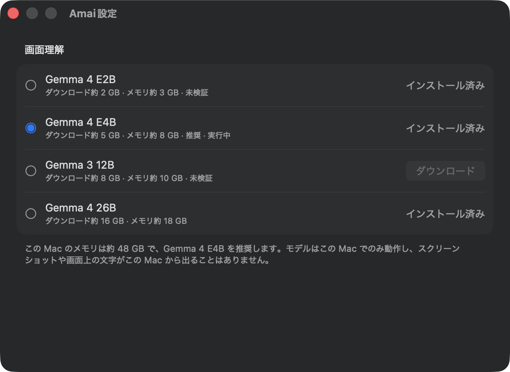
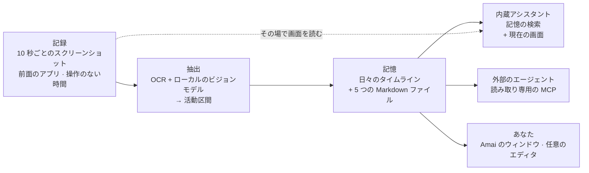

<div align="center">

<h1>
  <picture>
    <source media="(prefers-color-scheme: dark)" srcset="docs/assets/amai-wordmark-dark.svg">
    
  </picture>
</h1>

**Ambient Personal AI**

AI を使うたびに、自分の状況を一から説明し直していませんか。<br>
Amai は日々の活動をバックグラウンドで理解し続け、あなた個人の文脈を蓄積します。<br>
その文脈は、内蔵アシスタントからも、ふだん使っている AI エージェントからも利用できます。ローカルファースト、オープンソースで、プライバシーは自分で管理できます。

[](https://github.com/Penrose0v0/Amai/releases/latest)
[](#動作環境)
[](#動作環境)
[](Package.swift)
[](docs/mcp.md)
[](LICENSE)

[English](README.md) · [简体中文](README.zh-CN.md) · **日本語**

https://github.com/user-attachments/assets/e37c3621-7a5b-4beb-a040-862892749546

<sub>動画とスクリーンショットは <a href="samples/">samples/</a> の合成サンプルデータで、実在の人物の活動ではありません。</sub>

</div>

---

## クイックスタート

```bash
brew install --cask Penrose0v0/tap/amai
```

[GitHub Releases](https://github.com/Penrose0v0/Amai/releases/latest) から zip をダウンロードすることもできます。Apple Silicon 搭載の Mac と macOS 15 以降が必要です。詳しくは[インストール](#インストール)を参照してください。

## Amai が選ばれる理由

多くの AI アシスタントは、入力された内容しか知りません。新しいチャットを開くたび、ツールを替えるたびに、同じ説明を繰り返すことになります。いま何に取り組んでいるのか、先週何を決めたのか、画面に何が出ているのか。

Amai は、この文脈を代わりに蓄積する Ambient Personal AI です。あなたの作業を追い、タイムラインと長期記憶に整理し、必要な場所でその記憶を使えるようにします。Amai 自身のアシスタントでも、すでに使っているエージェントでも使えます。

| | |
|---|---|
| 🌙 **アンビエント** | 日記もプロンプトも不要です。Amai が画面を見て、タイムラインを自分で書きます。 |
| 🧠 **途切れない文脈** | 日々の活動が、プロジェクト・決定事項・習慣・目標についての長期記憶になります。文脈は翌日以降にも引き継がれます。 |
| 💬 **内蔵アシスタント** | ショートカットひとつでチャットが開きます。画面の内容をすでに把握しており、記憶をもとに出典つきで答えます。 |
| 🤖 **エージェント対応** | 読み取り専用の MCP サーバーにより、許可した範囲で Claude Desktop や Claude Code などのエージェントが記憶を検索できます。 |
| 🔒 **ローカルファースト** | バックグラウンドで記録した画面は、手元のパソコンで動くビジョンモデルが理解します。クラウドのモデルは任意で、何を読ませるかは自分で決められます。 |
| 📝 **プレーンな Markdown** | 記憶は `~/.amai/memory` にファイルとして保存され、どんなツールでも開いて編集・バックアップできます。 |
| 🔍 **出典をたどれる** | 記憶の各項目に元になった日付が記録され、その日に何をしていたかをさかのぼれます。 |

## 機能

以下は、現在のリリース **v0.2.1** で利用できる機能です。

### タイムラインと 1 日のまとめ

約 15 分ごとの画面の活動が、タイトル・要約・カテゴリ・所要時間を持つタイムラインの項目になります。夜のあいだに、Amai が前日の短いまとめを書きます。どちらも `daily/YYYY-MM-DD.md` に保存されます。

<p align="center"></p>

<table>
  <tr>
    <td width="50%"></td>
    <td width="50%"></td>
  </tr>
  <tr>
    <td align="center"><sub>1 日のまとめ</sub></td>
    <td align="center"><sub>タイムラインと記憶をまとめて検索</sub></td>
  </tr>
</table>

### 長期記憶

Amai は日々の記録から、**総合**・**仕事**・**健康**・**財務**・**目標**の 5 つの分野の記憶を更新します。分野ごとに 1 つの Markdown ファイルです。

- Amai が書き込むのは、自分用に区切られたブロックの中だけです。ファイルにあなたが書いた内容は変更されません。
- 各項目には元になった日付が表示されます。日付をクリックすると、その日のタイムラインに移動します。
- 置き換えや取り下げになった項目は変更履歴に残り、書き換えの前には毎回スナップショットが保存されます。
- 別のエディタで編集した内容も、数秒でアプリに反映されます。

<table>
  <tr>
    <td width="50%"></td>
    <td width="50%"></td>
  </tr>
  <tr>
    <td align="center"><sub>プロジェクトごとに整理された仕事の記憶</sub></td>
    <td align="center"><sub>各項目から元の日にさかのぼれる</sub></td>
  </tr>
</table>

### 内蔵アシスタント

どのアプリからでも **⌘⇧Space** でチャットパネルを開けます。ショートカットは設定で変更できます。

- **いま見ているものを把握しています。** 質問には、現在のアプリ、ウィンドウのタイトル、選択中のテキスト、画面上のテキストが添えられます。入力欄の横のスイッチで、スクリーンショットも添付できます。
- **記憶をもとに答えます。** モデルを呼び出す前に、Amai が関連するタイムラインの項目と記憶を検索しておきます。そのため、小さなローカルモデルでも「先週の火曜日は何をしていた？」に答えられます。回答の下には使った記憶が表示され、出典をクリックするとメインウィンドウで開きます。
- **意味検索は任意です。** 小さなローカルの埋め込みモデル（Qwen3-Embedding-0.6B、約 330 MB）を入れると、記録と言い回しが違う質問や、別の言語での質問でも記憶を見つけられます。入れていない場合はキーワード検索になります。
- **アプリをまたいで、選択したテキストを扱えます。** どのアプリでもテキストを選択してからパネルを開くと、翻訳・推敲・解説・要約が候補として表示され、ワンクリックで送れます。選択範囲について自分の言葉で質問することもできます。回答はコピーでき、生成し直すこともできます。
- **早めに準備を始めます。** パネルを開いた時点で画面の読み取りとローカルモデルのウォームアップを始め、入力している時間を準備に使います。M5 Pro と Gemma 4 E4B での実測では、送信から最初の文字まで約 0.2 秒でした。この準備をしない場合は約 2 秒です。
- **モデルは自分で選びます。** デフォルトはありません。ローカルモデル、自分の API キー（Anthropic、または OpenAI 互換のエンドポイント）、ChatGPT サブスクリプション、Claude サブスクリプションから選べます。選ぶまでアシスタントは使えません。アシスタントに読ませる記憶の分野も自分で決められ、健康と財務は初期状態では閉じています。
- **読み取り専用です。** アシスタントは記憶を変更せず、ほかのアプリを操作することもありません。会話の履歴はこのパソコンに保存され、設定から削除できます。

### デバイス上のモデル

画面の理解は、常に [MLX](https://github.com/ml-explore/mlx-swift) 上の Gemma ビジョンモデルでローカルに行います。モデルは設定から選んでダウンロードします。Amai は一日中動き続けるため、このパソコンのメモリの 3 分の 1 以下で動く、検証済みの最大のモデルを推奨します。

| モデル | ダウンロード | メモリ | 状態 |
|---|---|---|---|
| Gemma 4 E4B | 約 5 GB | 約 8 GB | デフォルト · 検証済み · メモリ 24 GB 以上で推奨 |
| Gemma 4 26B | 約 16 GB | 約 18 GB | 検証済み · メモリ 64 GB 以上で推奨 |
| Gemma 4 E2B | 約 2 GB | 約 3 GB | 未検証 · メモリの少ないパソコン向け |
| Gemma 3 12B | 約 8 GB | 約 10 GB | 未検証 |

<p align="center"></p>

長期記憶の整理に使うモデルは、初回セットアップで選びます。ローカルモデル、自分の Anthropic または OpenAI の API キー、ChatGPT サブスクリプション（公式の *Sign in with ChatGPT*）、ログイン済みの Claude Code を通じた Claude サブスクリプションから選べます。記憶の整理にクラウドを選んだ場合も、送信されるのは記憶のテキストだけで、スクリーンショットは送信されません。

アシスタントのモデルは別に選びます。選べるローカルモデルとクラウドの種類は上と同じです。画面理解と同じローカルモデルを選んだ場合、メモリ上では 1 つを共有します。アシスタントのローカルモデルは、パネルをすぐに使えるよう Amai の実行中ずっと読み込まれたままになるため、そのぶんのメモリは常に使われるものとして見積もってください。

### そのほか

- **初回セットアップ**：言語、記録される内容、画面収録の許可、モデルの選択、アシスタントの設定（スキップ可）を案内します。セットアップが終わるまで何も記録されません。
- **メニューバーアプリ**：いつでも記録を一時停止・再開でき、アイコンで現在の状態がわかります。新しいバージョンがあるとアイコンが青くなり、Homebrew でインストールした場合はメニューの **vX にアップデート** から更新して自動で再び開けます。
- **複数ディスプレイ**：すべてのディスプレイを記録し、作業中のディスプレイを最も重視します。
- **3 つの表示言語**（简体中文・English・日本語）。表示言語は、記憶を書く言語とは別に設定できます。

## しくみ



1. **記録**：10 秒ごと（バッテリー駆動時はより長い間隔）にすべてのディスプレイのスクリーンショットを撮り、前面のアプリと操作のない時間を記録します。スクリーンショットはコンパクトな HEVC 動画として短期バッファに保存されます。
2. **抽出**：各フレームを Apple Vision の OCR とローカルのビジョンモデルで読み取り、*見えたもの*と*推測したもの*を分けて記録します。そのうえでフレームを活動にまとめます。
3. **記憶**：活動をその日の daily ファイルに書き込みます。午前 4 時ごろに前日をまとめ、長期記憶の各分野を更新します。総合は週に 1 回更新されます。
4. **内蔵アシスタント**：決まった 1 回の流れで答えます。現在の画面を読み、記憶を検索し（質問に日付があればその日のタイムライン、加えてキーワード検索と任意の意味検索）、モデルを 1 回呼び出します。記憶は読むだけで、MCP と同じ読み取り専用の Memory API を通します。
5. **外部のエージェント**：読み取り専用の MCP サーバーを通じて、同じ記憶のうち、あなたが開いた分野だけを読みます。

詳しくは[アーキテクチャ](docs/architecture.md)と[記憶システム](docs/memory.md)を参照してください。

## プライバシー

Amai は画面を見るアプリなので、プライバシーは後から付けた設定ではなく、設計の一部です。

- **バックグラウンドで記録した内容はパソコンの外に出ません。** ビジョンモデルはローカルで動き、バックグラウンドのスクリーンショットがアップロードされることはありません。Amai が自分から行う通信は、Hugging Face からのモデルのダウンロードと、6 時間ごとに GitHub で新しいバージョンを確認することだけで、個人データは送信しません。
- **元のスクリーンショットは一時的です。** 最長 72 時間または 2 GB のどちらかに達した時点で削除されます。
- **機密性の高い場面はスキップします。** パスワード欄への入力中や、パスワード管理アプリ（1Password、Bitwarden、KeePassXC、キーチェーンアクセス）が前面にあるあいだは記録しません。除外が確実に効いていることを確認できない場合、そのフレームは破棄します。
- **キー入力は記録しません。** 記録するのはアプリの切り替えと操作のない時間だけです。
- **認証情報はマスクされます。** OCR のテキストは保存前にマスクされ、ログには件数と所要時間だけが残り、画面の内容は残りません。
- **クラウドの利用は任意です。** 記憶の整理がクラウドに送られるのは、クラウドを選んだ場合だけで、そのときも送信されるのは記憶のテキストだけです。
- **クラウドのアシスタントに送るのは、会話に必要な内容だけです。** アシスタントにクラウドのモデルを選ぶと、Amai は送信される内容を示し、一度だけ確認を求めます。送信されるのは、質問と会話、選択中のテキスト、現在のアプリ名と画面上のテキスト、添付した場合のスクリーンショット、許可した分野から検索された記憶です。送信はアシスタントを使っているときだけです。ローカルモデルの場合、これらがパソコンの外に出ることはありません。
- **アシスタントが画面を読むのは、開いたときだけです。** バックグラウンドの記録と同じ除外ルールに従い、パスワード欄や除外したアプリが前面にあるあいだは読み取りません。選択中のテキストの読み取りには任意のアクセシビリティの許可を使い、その時点でだけ読みます。Amai がキーボードや選択範囲を監視することはありません。
- **すべて確認・削除できます。** タイムラインから任意の期間を削除でき、Markdown ファイルは自由に編集・削除でき、アシスタントの会話は設定から削除でき、メニューバーからいつでも一時停止できます。

## AI エージェントとの連携（MCP）

Amai には読み取り専用の MCP サーバー `amai-mcp` が同梱されており、**初期状態ではオフ**です。オンにすると、次の 3 つのツールを提供します。

| ツール | 返す内容 |
|---|---|
| `search_memory` | 一致した記憶の項目（分野、日付、出典の日付つき） |
| `get_timeline` | 指定した日の活動と 1 日のまとめ（`today`、`yesterday` または日付） |
| `get_memory` | 1 つの分野の記憶。特定のセクションやプロジェクトだけを取得することも可能 |

`~/Library/Application Support/Amai/config.json` でオンにし、エージェントに読ませる分野を選びます。初期状態で読めるのは `general`、`work`、`goals` だけで、`daily`、`health`、`finance` は追加するまで閉じたままです。

```json
"mcp": { "enabled": true, "categories": ["general", "work", "goals"] }
```

そのうえでエージェントに追加します。

```bash
# Claude Code
claude mcp add amai -- /Applications/Amai.app/Contents/MacOS/amai-mcp
```

```jsonc
// Claude Desktop: ~/Library/Application Support/Claude/claude_desktop_config.json
{ "mcpServers": { "amai": { "command": "/Applications/Amai.app/Contents/MacOS/amai-mcp" } } }
```

このサーバーは記憶に書き込まず、ネットワークにも接続しません。ただし、エージェントが読んだ内容はそのエージェントが使うモデルのサービスに送られるため、共有してもよい分野だけを開いてください。詳しくは [docs/mcp.md](docs/mcp.md)（中国語）を参照してください。

## 使い方の例

- **「今週、実際に何をしたっけ？」** 記憶をたどる代わりに、タイムラインと 1 日のまとめを見返すか、アシスタントに聞けます。
- **前回の続きから再開する。** プロジェクトの記憶には決定事項・未解決の課題・進捗が残り、それぞれ元の日にさかのぼれます。
- **前置きなしで質問する。** 作業中の画面の上でアシスタントを開くだけです。画面も、選択範囲も、あなたの記憶も、すでに手元にあります。
- **テキストをその場で扱う。** どのアプリでも段落を選択して、ウィンドウを切り替えずに翻訳・推敲・解説・要約ができます。
- **エージェントに本当の文脈を渡す。** 回答の前に、Claude があなたの今のプロジェクトや目標を参照できます。自分で貼り付ける必要はありません。
- **自分の履歴を自分で持つ。** すべてはディスク上の Markdown です。grep するのも、バージョン管理するのも、好きな方法で同期するのも自由です。

## インストール

### Homebrew（推奨）

```bash
brew install --cask Penrose0v0/tap/amai
```

### 手動でダウンロード

[GitHub Releases](https://github.com/Penrose0v0/Amai/releases/latest) から `Amai-<バージョン>.zip` をダウンロードして展開し、`Amai.app` を `/Applications` に移動してから、次のコマンドを実行します。

```bash
xattr -dr com.apple.quarantine /Applications/Amai.app
```

Amai は署名済みですが、**まだ公証（notarization）されていません**。Homebrew の cask は隔離属性を自動で取り除きます。手動でダウンロードした場合は上のコマンドが必要です。

### 動作環境

- Apple Silicon 搭載の Mac、macOS 15 Sequoia 以降
- デフォルトのモデル（Gemma 4 E4B）にはメモリ 24 GB 以上。メモリが少ない場合は Gemma 4 E2B を使えます
- モデル用のディスク容量（Gemma 4 E4B で約 5 GB、初回にダウンロード）と、最大 2 GB のスクリーンショット用短期バッファ
- アシスタントでローカルモデルを使う場合：上記に加えてそのモデルのぶんのメモリ（画面理解と同じモデルの場合は不要）

### 初回起動

Amai はメニューバーに常駐します。一度開くと初回セットアップが始まり、画面収録の許可を求め、モデルの選択とダウンロードを案内します。最後に**記録を開始**をクリックするまで記録は始まりません。アシスタントは同じ流れの中でも、あとから設定でも設定できます。アクセシビリティの許可は任意で、選択中のテキストを読むためだけに使います。

### データの保存場所

| 場所 | 内容 |
|---|---|
| `~/.amai/memory/` | 記憶（Markdown）。場所は変更できます。 |
| `~/Library/Application Support/Amai/` | 設定、スクリーンショットの短期バッファ、抽出結果、スナップショット、検索インデックス、アシスタントの会話履歴 |

`brew uninstall --cask amai` でアプリは削除されます。記憶のファイルは、`brew uninstall --zap` でも削除されません。

## 現状とロードマップ

Amai は **v0.2.1**、作者自身が毎日使いながら開発している初期リリースです。粗い部分もあります。現在のリリースは Apple Silicon 搭載の Mac で動作します。

**リリース済み**

- **v0.1.0**：画面の記録、タイムラインと 1 日のまとめ、Markdown の長期記憶、デバイス上のモデル、記憶の整理に使うクラウド／サブスクリプション、読み取り専用の MCP サーバー、初回セットアップ、3 つの表示言語。
- **v0.2.0**：内蔵アシスタント（チャットパネル、出典つきの記憶への質問応答、キーワード検索と意味検索、アプリをまたいだ選択テキストへの候補操作）、Homebrew でインストールした場合のアプリ内アップデート、新しいロゴとアイコン。
- **v0.2.1**：表示言語の切り替えに関する修正。

**実装済み・未リリース**

- アシスタントの記憶検索が、固定の上位 6 件ではなくトークン予算（デフォルト 4K）に収まるだけ選ぶようになり、複数の根拠が必要な質問でより多くの根拠を渡せます。認識できる日付の書き方も増えました（「3 日前」、英語の月名、英語と日本語の曜日）。
- チャットパネルを閉じて 3 分以上たってから開くと、新しい会話が始まります。前の会話は履歴に残ります。
- 自分の記憶の上で、記憶への質問応答と検索を評価する開発用ツール（`amai-memory qa-eval`、[docs/qa-eval.md](docs/qa-eval.md)（中国語）を参照）。

**既知の制限**

- まだ公証されていません。
- 記録中に Amai が終了すると、直前の数秒分の画面の動画が失われることがあります。
- ローカルモデルで整理した記憶は、大規模なクラウドモデルより品質が下がります。特に健康と財務で顕著です。[評価の記録](docs/roadmap.md)（中国語）を参照してください。
- アシスタントの回答の質は、検索と使うモデルに左右されます。作者が v0.2 で行った最初の評価（31 日分の実際の記憶、100 問、ローカルで動かした Gemma 4 26B）では、全体の正答率は 61% でした。答えられる質問の正答率は 55%、答えられない質問を正しく断れた割合は 93% です。上に挙げた検索の変更は主な原因に対処するものですが、人手でラベルを付けた質問での再評価はまだ行っていません。
- アシスタントのクラウドのモデルは、ローカルモデルほど十分にテストされていません。
- 選択中のテキストを読めないアプリがあります（表計算のセルなど）。数式は LaTeX のまま表示されます。ショートカットはいくつかの候補から選ぶ方式です。
- MCP をオンにするには設定ファイルを編集する必要があります。

**予定**

- システム音声とマイクの文字起こし
- 設定ウィンドウでの MCP のオン／オフと公開する分野の選択
- 公証
- 長時間動作時の安定性とリソース消費の計測

**検討中（確約はしません）**

- ほかのプラットフォーム。iOS の画面キャプチャについての調査と概念実証がリポジトリにありますが、実機での計測はまだ行っていません。
- アシスタントへのエージェント機能の追加。現在は質問に答えるだけで、操作の実行や記憶への書き込みは行いません。

詳細と進捗は [docs/roadmap.md](docs/roadmap.md)（中国語）にあります。

## 開発

macOS 15 以降、Xcode 26（Metal ツールチェーンのコンポーネントを含む）、Swift 6 が必要です。

```bash
swift build                  # ビルド
swift test                   # MLX のモデルの重みを必要としないテスト
./scripts/bundle.sh          # .build/Amai.app を組み立てる（mlx.metallib を含め、署名する）
open .build/Amai.app         # 実行（メニューバーアプリ）
./scripts/memory-preview.sh  # 合成サンプルデータだけでメインウィンドウを開く
```

SwiftPM は Metal カーネルをコンパイルしないため、`swift run` では MLX の推論を実行できません。`bundle.sh` を使ってください。

`bundle.sh` は、「Apple Development」証明書があればそれで署名するため、再ビルドしても画面収録やキーチェーンの許可が保たれます。証明書がない場合は、`./scripts/setup-dev-cert.sh` で作成する自己署名証明書 `Amai Local Dev` を使います。`AMAI_SIGN_IDENTITY` で別の署名 ID を指定することもできます。リリース用のパッケージングについては [docs/release.md](docs/release.md) を参照してください。

### アーキテクチャ

Amai は、**記録 → 抽出 → 記憶**の 3 層を厳密に分けた Swift パッケージです。内蔵アシスタントと MCP サーバーはこのパイプラインの横にあり、記憶を読むだけです。

```text
Sources/
├── AmaiCore/          データ契約（PerceptionEvent、Observation、ActivitySegment、MemoryEntry、ChatModel）、時計、ログ
├── AmaiPerception/    画面と操作の記録、アクセス許可、元データのバッファ、プライバシーポリシー、その場での画面の読み取り、OCR
├── AmaiInference/     ローカルモデルのランタイム（mlx-swift-lm）：読み込み、重みの共有、スケジューリング、会話のキャッシュ、埋め込み
├── AmaiExtraction/    フレームの選別、観察の抽出、バッチ処理、活動の区切り
├── AmaiMemory/        Markdown の保存、整理、インデックス（GRDB / SQLite FTS5 + ベクトル）、読み取り専用の Memory API
├── AmaiMemoryUI/      タイムラインと記憶ブラウザの画面
├── AmaiCloud/         記憶の整理とアシスタントに使う任意のクラウド／サブスクリプションのクライアント
├── AmaiAssistant/     アシスタント（画面なし）：文脈の組み立て、記憶の検索、会話の保存
├── AmaiMCP/           Memory API の上に構築した MCP ツール
├── AmaiMCPServer/     amai-mcp の実行ファイル（stdio）
├── AmaiMemoryCLI/     開発用 CLI amai-memory
├── AmaiExtractionCLI/ 開発用 CLI amai-extraction
├── AmaiMemoryEval/    記憶の整理の評価（開発時のみ）
├── AmaiQAEval/        記憶への質問応答と検索の評価（開発時のみ）
└── Amai/              メニューバーアプリ、チャットパネル、設定、初回セットアップ、各層の組み立て
```

| ドキュメント | 内容 |
|---|---|
| [docs/product.md](docs/product.md) | プロダクトの定義と範囲 |
| [docs/architecture.md](docs/architecture.md) | 層、モジュール、データ契約 |
| [docs/memory.md](docs/memory.md) | Markdown の記憶の形式と整理のしくみ |
| [docs/mcp.md](docs/mcp.md) | MCP サーバーの設定 |
| [docs/qa-eval.md](docs/qa-eval.md) | 記憶への質問応答と検索の評価 |
| [docs/release.md](docs/release.md) | パッケージングと配布 |
| [docs/decisions/](docs/decisions/) | アーキテクチャ決定記録 |
| [AGENTS.md](AGENTS.md) | コントリビューターとコーディングエージェント向けのエンジニアリング方針 |

プロジェクトのドキュメントは現在、中国語で書かれています。

## 謝辞

Amai の設計は、[Dayflow](https://github.com/JerryZLiu/Dayflow)、[Screenpipe](https://github.com/mediar-ai/screenpipe)、[OpenClaw](https://github.com/openclaw/openclaw)、[Hermes Agent](https://github.com/NousResearch/hermes-agent) などのオープンソースプロジェクトから着想を得ています。

これらのプロジェクトとコントリビューターの皆さんに、オープンソースのエコシステムを支えてくださっていることへの感謝を申し上げます。

## ライセンス

[MIT](LICENSE)
