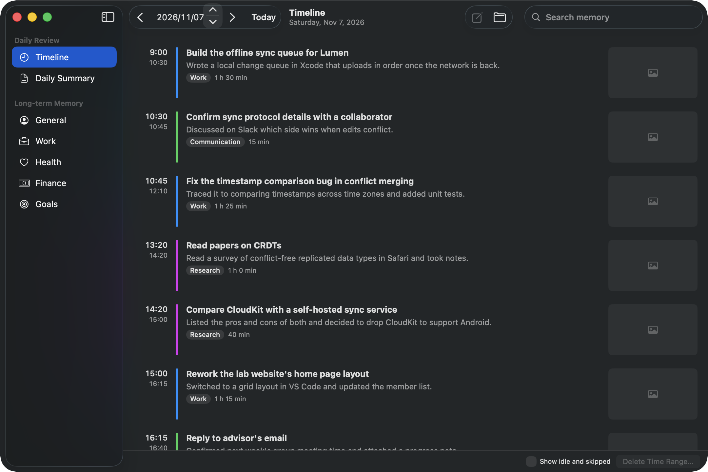
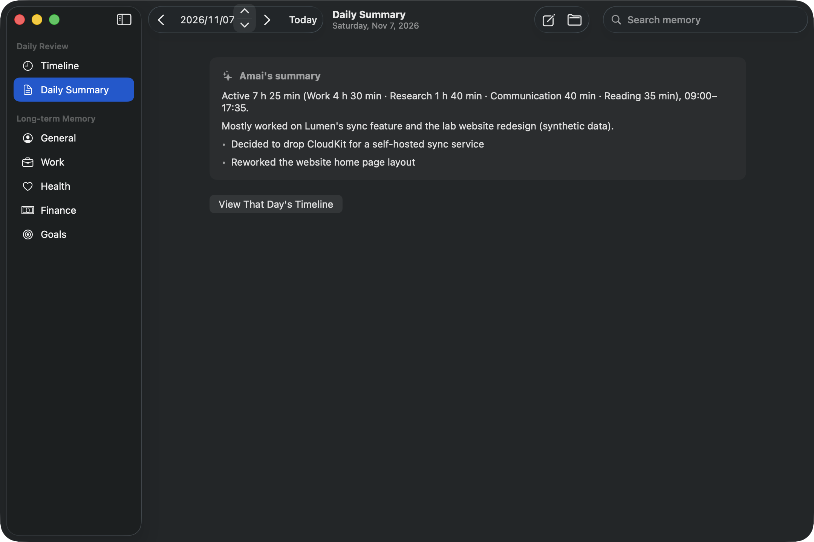
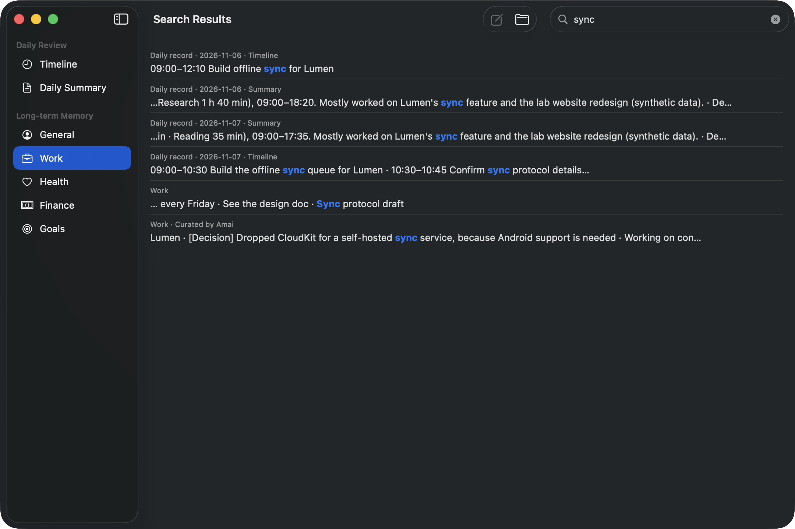
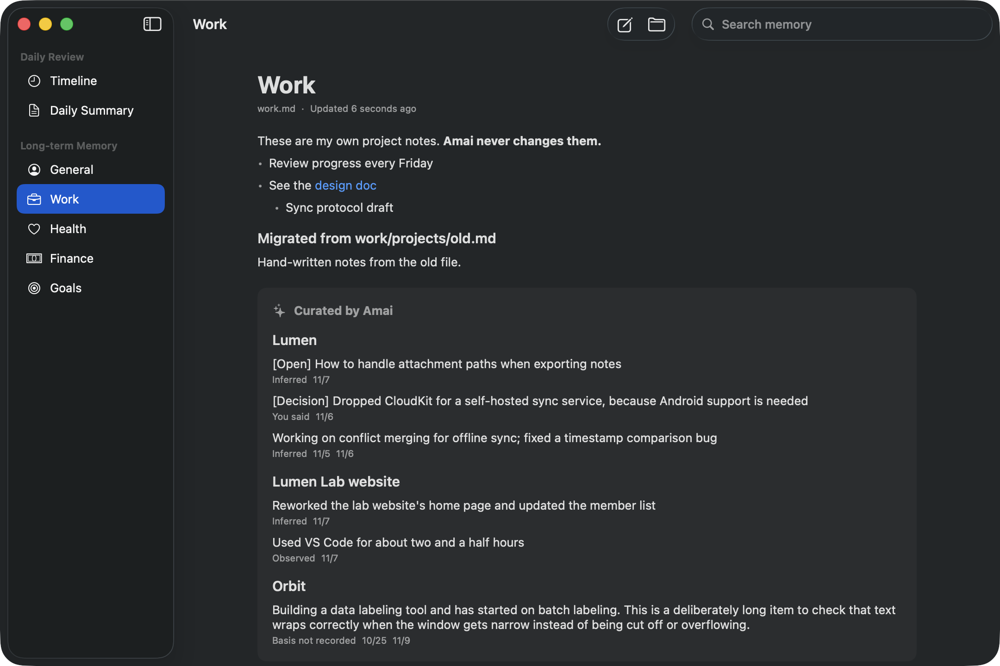
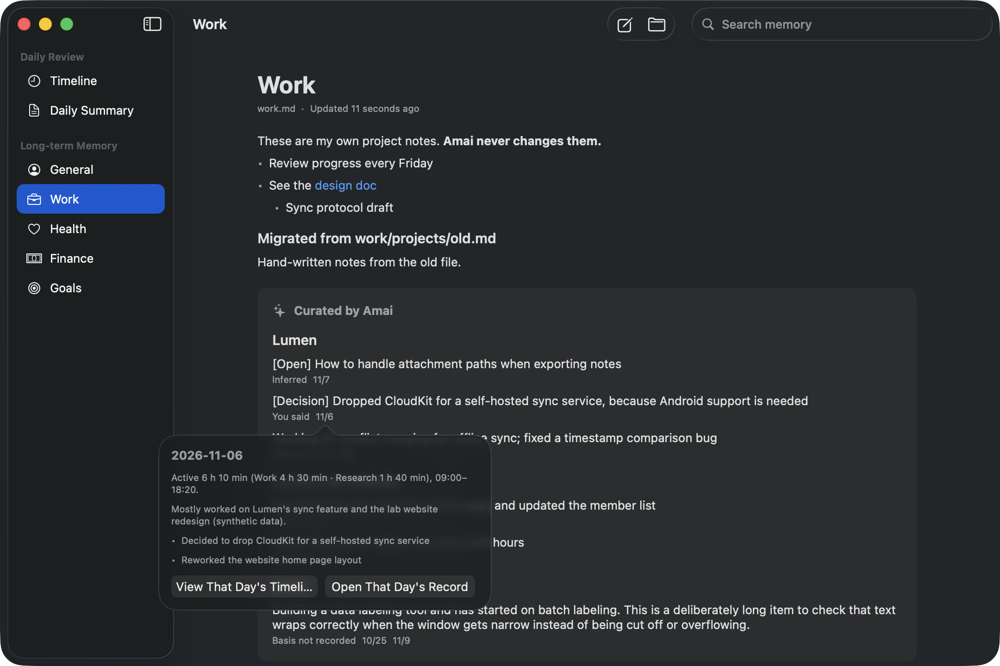
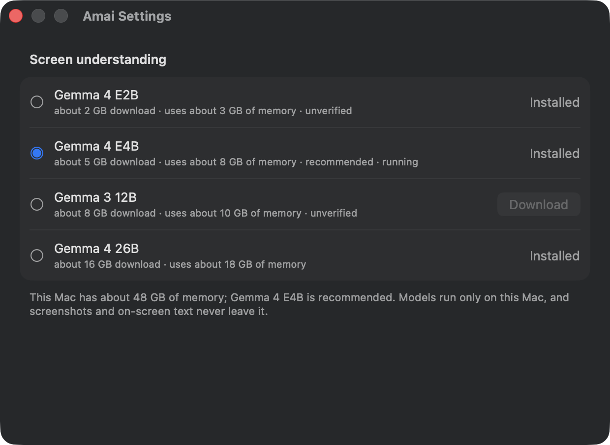
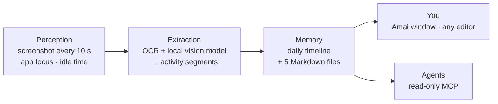

<div align="center">

# Amai

**Ambient Personal AI for macOS**

Amai quietly notes what you do on your Mac and turns it into a daily timeline and long-term memory:<br>
plain Markdown, on your device, ready for your AI agents.

[](https://github.com/Penrose0v0/Amai/releases/latest)
[](#requirements)
[](#requirements)
[](Package.swift)
[](docs/mcp.md)
[](LICENSE)

**English** · [简体中文](README.zh-CN.md)



<sub>Screenshots show synthetic sample data from <a href="samples/">samples/</a>, not a real person's activity.</sub>

</div>

---

## Quick start

```bash
brew install --cask Penrose0v0/tap/amai
```

Or download the zip from [GitHub Releases](https://github.com/Penrose0v0/Amai/releases/latest). Requires an Apple Silicon Mac with macOS 15 or later; see [Install](#install) for details.

## Why Amai

Most AI assistants know only what you type into them. Amai builds that context for you, in the background, and keeps it yours.

| | |
|---|---|
| 🌙 **Ambient** | No journaling, no prompts. Amai watches the screen and writes the timeline itself. |
| 🔒 **Local first** | Screenshots are understood by a vision model running on your Mac. They never leave it. |
| 📝 **Plain Markdown** | Memory lives in `~/.amai/memory` as files you can open, edit and back up with any tool. |
| 🔍 **Traceable** | Every remembered item records where it came from: something you said, something observed, or something inferred. |
| 🤖 **Agent ready** | A read-only MCP server lets Claude Desktop, Claude Code and other agents search your memory with your permission. |

## Features

These are the features in **v0.1.0**.

### Timeline and daily summary

Every ~15 minutes of screen activity becomes one or more timeline entries with a title, a summary, a category and a duration. Overnight, Amai writes a short summary of the previous day. Both go into `daily/YYYY-MM-DD.md`.

<table>
  <tr>
    <td width="50%"></td>
    <td width="50%"></td>
  </tr>
  <tr>
    <td align="center"><sub>Daily summary</sub></td>
    <td align="center"><sub>Search across timeline and memory</sub></td>
  </tr>
</table>

### Long-term memory

From each day's record, Amai updates five memory areas: **General**, **Work**, **Health**, **Finance** and **Goals**. Each is a single Markdown file.

- Amai writes only inside its own marked block. Anything you write in the file is never changed.
- Each item shows its basis (*you said*, *you confirmed*, *observed* or *inferred*) and the days it came from. Click a date to jump to that day's timeline.
- Replaced or retired items go to a change history, and a snapshot is saved before every rewrite.
- Edits made in another editor show up in the app within seconds.

<table>
  <tr>
    <td width="50%"></td>
    <td width="50%"></td>
  </tr>
  <tr>
    <td align="center"><sub>Work memory, grouped by project</sub></td>
    <td align="center"><sub>Every item links back to its source day</sub></td>
  </tr>
</table>

### On-device models

Screen understanding always runs locally with Gemma vision models on [MLX](https://github.com/ml-explore/mlx-swift). Pick and download a model in Settings. Because Amai runs all day, it recommends the largest verified model that needs no more than a third of your Mac's memory.

| Model | Download | Memory | Status |
|---|---|---|---|
| Gemma 4 E4B | ~5 GB | ~8 GB | Default · verified · recommended from 24 GB |
| Gemma 4 26B | ~16 GB | ~18 GB | Verified · recommended from 64 GB |
| Gemma 4 E2B | ~2 GB | ~3 GB | Not yet verified · suggested on smaller Macs |
| Gemma 3 12B | ~8 GB | ~10 GB | Not yet verified |

<p align="center"></p>

For organizing long-term memory, you choose the source during onboarding: the local model, your own Anthropic or OpenAI API key, a ChatGPT subscription (official *Sign in with ChatGPT*), or a Claude subscription through your signed-in Claude Code. A cloud source receives memory text only, never screenshots.

### More

- **First-run onboarding** covers languages, what gets recorded, Screen Recording permission and model choice. Nothing is recorded until you finish it.
- **Menu bar app**: pause or resume recording at any time; the icon always shows the current state.
- **Multiple displays** are captured, with the focused display weighted most.
- **Three languages** (简体中文, English, 日本語) for the interface, set separately from the language memory is written in.

## How it works



1. **Perception** takes a screenshot of every display every 10 seconds (longer on battery) and records which app is in front and how long you have been idle. Screenshots are stored as compact HEVC video in a short-term buffer.
2. **Extraction** reads each frame with Apple Vision OCR and the local vision model, keeping what was *seen* separate from what was *inferred*. It then groups the frames into activities.
3. **Memory** writes activities into the daily file. Around 4 a.m. it summarizes the previous day and updates the long-term memory areas. General is refreshed weekly.

More detail: [architecture](docs/architecture.md) · [memory system](docs/memory.md).

## Privacy

Amai sees your screen, so privacy is built into the design rather than added as a setting.

- **Screenshots stay on your Mac.** The vision model runs locally, and model downloads only contact Hugging Face.
- **Raw screenshots are temporary.** They are kept for at most 72 hours or 2 GB, whichever comes first, then deleted.
- **Sensitive moments are skipped.** Nothing is captured while you type into a password field, or while a password manager (1Password, Bitwarden, KeePassXC, Keychain Access) is in front. If an exclusion can't be confirmed, the frame is dropped.
- **Keystrokes are never recorded.** Amai notes only app switches and how long you have been idle.
- **Credentials are masked** in OCR text before it is saved, and logs contain counts and timings only, never screen content.
- **Cloud use is opt-in.** Memory organization goes to a cloud provider only if you choose one, and then only memory text is sent.
- **You can see and delete everything.** Delete any time range from the timeline, edit or remove any Markdown file, and pause from the menu bar.

## Connect your AI agents (MCP)

Amai ships a read-only MCP server, `amai-mcp`, inside the app. It is **off by default**. Once enabled, it exposes three tools:

| Tool | What it returns |
|---|---|
| `search_memory` | Matching memory items with their area, date and basis |
| `get_timeline` | One day's activities and daily summary (`today`, `yesterday` or a date) |
| `get_memory` | One memory area, optionally a single section or project |

Turn it on in `~/Library/Application Support/Amai/config.json`, choosing which areas agents may read. By default only `general`, `work` and `goals` are readable; `daily`, `health` and `finance` stay closed until you add them.

```json
"mcp": { "enabled": true, "categories": ["general", "work", "goals"] }
```

Then add it to your agent:

```bash
# Claude Code
claude mcp add amai -- /Applications/Amai.app/Contents/MacOS/amai-mcp
```

```jsonc
// Claude Desktop: ~/Library/Application Support/Claude/claude_desktop_config.json
{ "mcpServers": { "amai": { "command": "/Applications/Amai.app/Contents/MacOS/amai-mcp" } } }
```

The server never writes to memory and makes no network requests. Whatever an agent reads is sent to that agent's model provider, so open only the areas you are comfortable sharing. Full guide: [docs/mcp.md](docs/mcp.md).

## Use cases

- **"What did I actually do this week?"** Read the timeline and daily summaries instead of reconstructing your week from memory.
- **Pick up where you left off.** Project memory keeps decisions, open questions and progress, each linked to the day it came from.
- **Give agents real context.** Let Claude look up your current projects and goals before it answers, without pasting them in.
- **Own your history.** Everything is Markdown on your disk: grep it, version it, sync it however you like.

## Install

### Homebrew (recommended)

```bash
brew install --cask Penrose0v0/tap/amai
```

### Manual download

Download `Amai-<version>.zip` from [GitHub Releases](https://github.com/Penrose0v0/Amai/releases/latest), unzip it, move `Amai.app` to `/Applications` and run:

```bash
xattr -dr com.apple.quarantine /Applications/Amai.app
```

Amai is signed but **not yet notarized**. The Homebrew cask removes the quarantine flag for you; a manual download needs the command above.

### Requirements

- Apple Silicon Mac, macOS 15 Sequoia or later
- 24 GB of memory or more for the default model (Gemma 4 E4B); smaller Macs can use Gemma 4 E2B
- Disk space for the model (~5 GB for Gemma 4 E4B, downloaded on first run) plus up to 2 GB of short-term screenshot buffer

### First run

Amai lives in the menu bar. Open it once to start onboarding. It asks for Screen Recording permission and lets you choose and download the models. Recording starts only when you click **Start recording** at the end.

### Your data

| Location | Contents |
|---|---|
| `~/.amai/memory/` | Your memory (Markdown). Configurable. |
| `~/Library/Application Support/Amai/` | Settings, short-term screenshot buffer, extraction results, snapshots |

`brew uninstall --cask amai` removes the app. Your memory files are never deleted, not even by `brew uninstall --zap`.

## Status and roadmap

Amai is at **v0.1.0**, an early release built and used daily by its author. Expect rough edges.

**Known limitations**

- Not notarized yet.
- If Amai quits while recording, the last few seconds of screen video may be lost.
- Memory quality from the local model is lower than from large cloud models, especially for Health and Finance. See the [evaluation notes](docs/roadmap.md).

**Planned (not in v0.1.0)**

- System audio and microphone transcription
- MCP and memory-area controls in the Settings window
- Notarization
- Semantic (embedding) search and conversational Q&A over memory

Details and progress: [docs/roadmap.md](docs/roadmap.md).

## Development

Requires macOS 15+, Xcode 26 (with the Metal toolchain component) and Swift 6.

```bash
swift build                  # build
swift test                   # tests that don't need MLX model weights
./scripts/bundle.sh          # assemble .build/Amai.app (with mlx.metallib, signed)
open .build/Amai.app         # run (menu bar app)
./scripts/memory-preview.sh  # open the main window on synthetic sample data only
```

`swift run` can't reach MLX inference because SwiftPM doesn't compile the Metal kernels. Use `bundle.sh`.

`bundle.sh` signs with your "Apple Development" certificate if you have one, so Screen Recording and Keychain permissions survive rebuilds. Without one, it falls back to the self-signed `Amai Local Dev` certificate made by `./scripts/setup-dev-cert.sh`. Set `AMAI_SIGN_IDENTITY` to choose another identity. Release packaging is described in [docs/release.md](docs/release.md).

### Architecture

Amai is a Swift package with three strictly separated layers: **Perception → Extraction → Memory**.

```text
Sources/
├── AmaiCore/         Data contracts (PerceptionEvent, Observation, ActivitySegment, MemoryEntry), clock, logging
├── AmaiPerception/   Screen and interaction capture, permissions, raw buffer, privacy policy
├── AmaiExtraction/   OCR, local model provider (mlx-swift-lm), batching, activity segmentation
├── AmaiMemory/       Markdown store, consolidation, index (GRDB / SQLite FTS5), read-only Memory API
├── AmaiMemoryUI/     Timeline and memory browser views
├── AmaiCloud/        Optional cloud and subscription clients for memory organization
├── AmaiMCP/          MCP tools on top of the Memory API
├── AmaiMCPServer/    amai-mcp executable (stdio)
├── AmaiMemoryCLI/    amai-memory developer CLI
└── Amai/             Menu bar app, settings, onboarding, wiring
```

| Document | Contents |
|---|---|
| [docs/product.md](docs/product.md) | Product definition and scope |
| [docs/architecture.md](docs/architecture.md) | Layers, modules and data contracts |
| [docs/memory.md](docs/memory.md) | Markdown memory format and consolidation |
| [docs/mcp.md](docs/mcp.md) | MCP server setup |
| [docs/release.md](docs/release.md) | Packaging and distribution |
| [docs/decisions/](docs/decisions/) | Architecture decision records |
| [AGENTS.md](AGENTS.md) | Engineering principles for contributors and coding agents |

Project documentation is currently written in Chinese.

## Acknowledgements

Amai's design was inspired by open-source projects including [Dayflow](https://github.com/JerryZLiu/Dayflow), [Screenpipe](https://github.com/mediar-ai/screenpipe), [OpenClaw](https://github.com/openclaw/openclaw) and [Hermes Agent](https://github.com/NousResearch/hermes-agent).

Thanks to these projects and their contributors for supporting the open-source ecosystem.

## License

[MIT](LICENSE)
