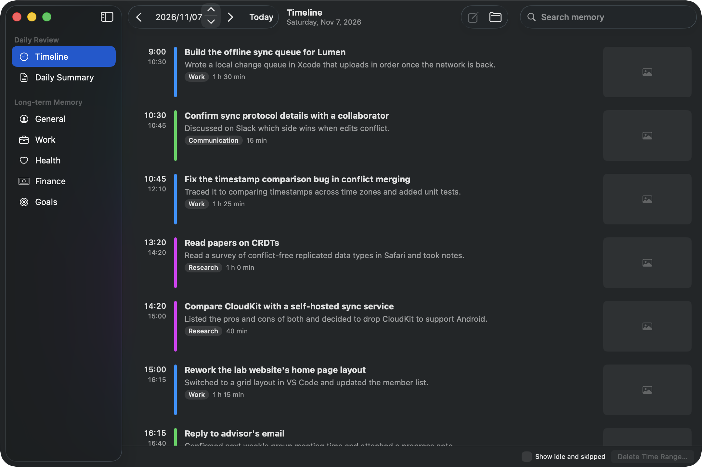
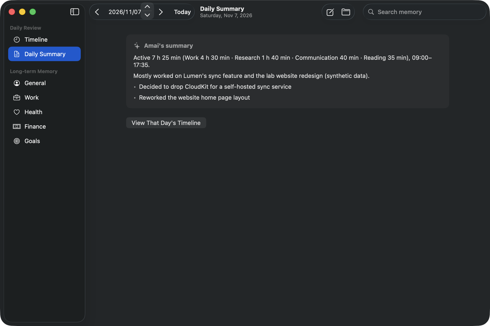
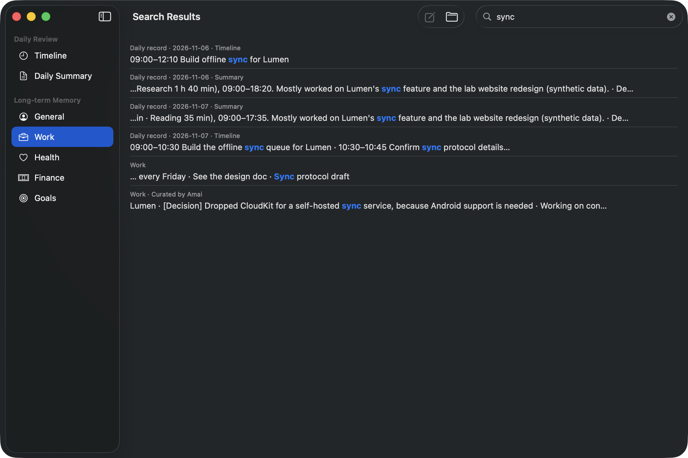
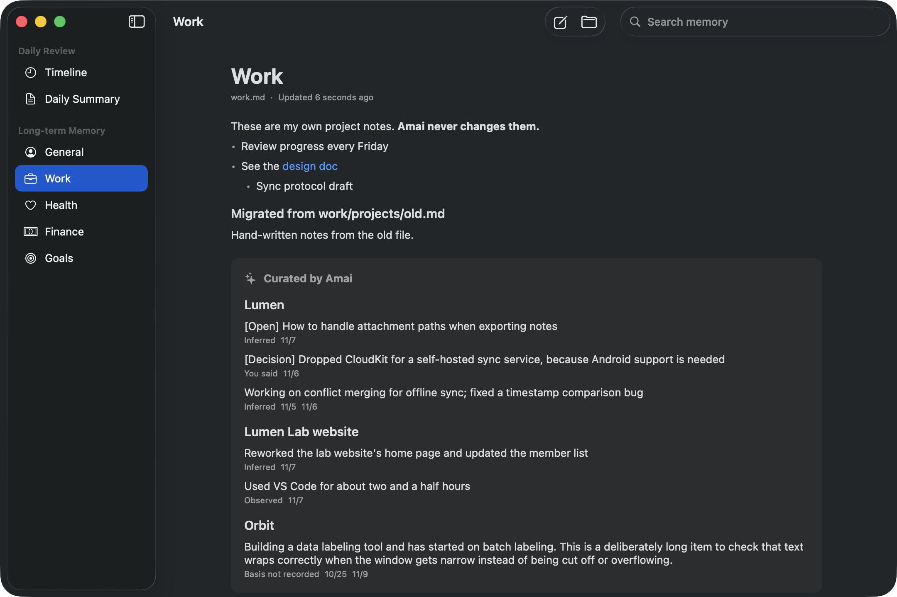
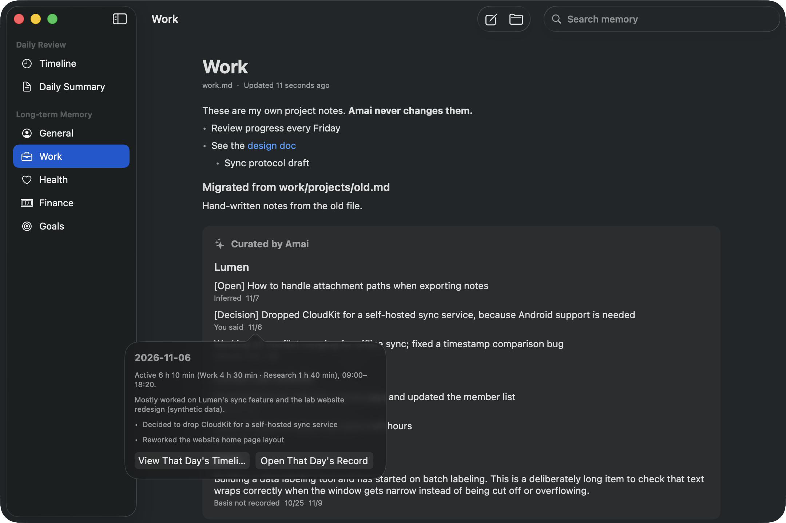
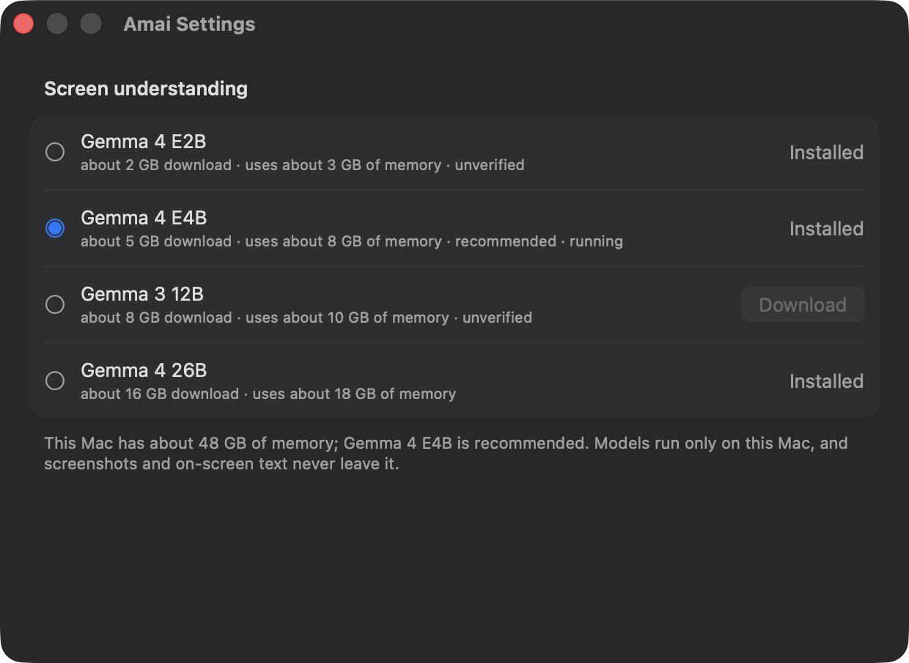
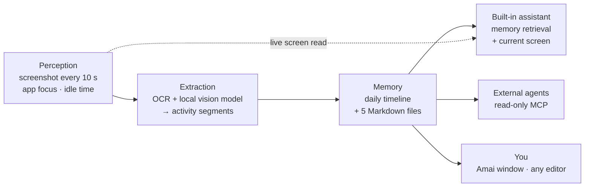

<div align="center">

<h1>
  <picture>
    <source media="(prefers-color-scheme: dark)" srcset="docs/assets/amai-wordmark-dark.svg">
    
  </picture>
</h1>

**Ambient Personal AI**

Every AI assistant starts by asking you to explain yourself again.<br>
Amai follows your day-to-day activity in the background and builds up personal context<br>
that its built-in assistant and your other AI agents can use. Local first, open source, under your control.

[](https://github.com/Penrose0v0/Amai/releases/latest)
[](#requirements)
[](#requirements)
[](Package.swift)
[](docs/mcp.md)
[](LICENSE)

**English** · [简体中文](README.zh-CN.md) · [日本語](README.ja.md)

https://github.com/user-attachments/assets/e37c3621-7a5b-4beb-a040-862892749546

<sub>Screenshots and the video show synthetic sample data from <a href="samples/">samples/</a>, not a real person's activity.</sub>

</div>

---

## Quick start

```bash
brew install --cask Penrose0v0/tap/amai
```

Or download the zip from [GitHub Releases](https://github.com/Penrose0v0/Amai/releases/latest). Requires an Apple Silicon Mac with macOS 15 or later; see [Install](#install) for details.

## Why Amai

Most AI assistants know only what you type into them. Each new chat, and each new tool, starts with the same paragraph about what you are working on, what you decided last week and what is on your screen right now.

Amai is an Ambient Personal AI that builds this context for you. It keeps up with what you do, turns it into a timeline and long-term memory, and makes that memory available where you need it: in its own assistant, and in the agents you already use.

| | |
|---|---|
| 🌙 **Ambient** | No journaling, no prompts. Amai watches the screen and writes the timeline itself. |
| 🧠 **Continuous context** | Daily activity becomes long-term memory of your projects, decisions, habits and goals, so context carries over from one day to the next. |
| 💬 **Built-in assistant** | One shortcut opens a chat that already knows what is on your screen and can answer from your memory, with sources. |
| 🤖 **Agent ready** | A read-only MCP server lets Claude Desktop, Claude Code and other agents search your memory with your permission. |
| 🔒 **Local first** | Background capture is understood by a vision model running on your own device. Cloud models are optional, and you decide what they may read. |
| 📝 **Plain Markdown** | Memory lives in `~/.amai/memory` as files you can open, edit and back up with any tool. |
| 🔍 **Traceable** | Every remembered item records the days it came from, so you can go back to what you were doing then. |

## Features

These are the features in **v0.2.1**, the current release.

### Timeline and daily summary

Every ~15 minutes of screen activity becomes one or more timeline entries with a title, a summary, a category and a duration. Overnight, Amai writes a short summary of the previous day. Both go into `daily/YYYY-MM-DD.md`.

<p align="center"></p>

<table>
  <tr>
    <td width="50%"></td>
    <td width="50%"></td>
  </tr>
  <tr>
    <td align="center"><sub>Daily summary</sub></td>
    <td align="center"><sub>Search across timeline and memory</sub></td>
  </tr>
</table>

### Long-term memory

From each day's record, Amai updates five memory areas: **General**, **Work**, **Health**, **Finance** and **Goals**. Each is a single Markdown file.

- Amai writes only inside its own marked block. Anything you write in the file is never changed.
- Each item shows the days it came from. Click a date to jump to that day's timeline.
- Replaced or retired items go to a change history, and a snapshot is saved before every rewrite.
- Edits made in another editor show up in the app within seconds.

<table>
  <tr>
    <td width="50%"></td>
    <td width="50%"></td>
  </tr>
  <tr>
    <td align="center"><sub>Work memory, grouped by project</sub></td>
    <td align="center"><sub>Every item links back to its source day</sub></td>
  </tr>
</table>

### Built-in assistant

Press **⌘⇧Space** in any app to open the chat panel. The shortcut can be changed in Settings.

- **It knows what you are looking at.** Each question carries the current app, window title, selected text and the text on screen. A toggle next to the input attaches a screenshot as well.
- **It answers from your memory.** Amai retrieves the relevant timeline entries and memory items before the model is called, so even a small local model can answer "what did I work on last Tuesday?". The memory it used is listed under the answer, and each source opens in the main window.
- **Semantic search is optional.** With the small local embedding model (Qwen3-Embedding-0.6B, ~330 MB) installed, a question also finds memory that is worded differently or written in another language. Without it, retrieval falls back to keywords.
- **It works on selected text across apps.** Select text anywhere, then open the panel: translate, polish, explain and summarize appear as one-click suggestions, or ask your own question about the selection. Answers can be copied or regenerated.
- **It starts preparing early.** Opening the panel reads the screen and warms up the local model while you type. On an M5 Pro with Gemma 4 E4B, the first word arrived about 0.2 s after submitting, compared with about 2 s without this preparation.
- **You choose the model.** There is no default: pick a local model, your own API key (Anthropic, or any OpenAI-compatible endpoint), a ChatGPT subscription or a Claude subscription. Until you do, the assistant stays off. You also choose which memory areas it may read; Health and Finance are closed by default.
- **It is read-only.** The assistant does not change your memory and does not act in other apps. Conversations are stored on your device and can be deleted in Settings.

### On-device models

Screen understanding always runs locally with Gemma vision models on [MLX](https://github.com/ml-explore/mlx-swift). Pick and download a model in Settings. Because Amai runs all day, it recommends the largest verified model that needs no more than a third of your computer's memory.

| Model | Download | Memory | Status |
|---|---|---|---|
| Gemma 4 E4B | ~5 GB | ~8 GB | Default · verified · recommended from 24 GB |
| Gemma 4 26B | ~16 GB | ~18 GB | Verified · recommended from 64 GB |
| Gemma 4 E2B | ~2 GB | ~3 GB | Not yet verified · suggested for machines with less memory |
| Gemma 3 12B | ~8 GB | ~10 GB | Not yet verified |

<p align="center"></p>

For organizing long-term memory, you choose the source during onboarding: the local model, your own Anthropic or OpenAI API key, a ChatGPT subscription (official *Sign in with ChatGPT*), or a Claude subscription through your signed-in Claude Code. A cloud source for memory organization receives memory text only, never screenshots.

The assistant's model is chosen separately, from the same local models and cloud sources. If it uses the same local model as screen understanding, the two share one copy in memory. A local assistant model stays loaded while Amai runs so that the panel responds immediately, so count its memory as permanently in use.

### More

- **First-run onboarding** covers languages, what gets recorded, Screen Recording permission, model choice and the assistant (which you can skip). Nothing is recorded until you finish it.
- **Menu bar app**: pause or resume recording at any time; the icon always shows the current state, and turns blue when a new version is available. For a Homebrew install, **Update to vX** in the menu upgrades and reopens Amai.
- **Multiple displays** are captured, with the focused display weighted most.
- **Three languages** (简体中文, English, 日本語) for the interface, set separately from the language memory is written in.

## How it works



1. **Perception** takes a screenshot of every display every 10 seconds (longer on battery) and records which app is in front and how long you have been idle. Screenshots are stored as compact HEVC video in a short-term buffer.
2. **Extraction** reads each frame with Apple Vision OCR and the local vision model, keeping what was *seen* separate from what was *inferred*. It then groups the frames into activities.
3. **Memory** writes activities into the daily file. Around 4 a.m. it summarizes the previous day and updates the long-term memory areas. General is refreshed weekly.
4. **Built-in assistant** answers in one fixed pass: it reads the current screen, retrieves memory (the timeline of any day you mention, plus keyword and optional semantic search), and calls the model once. It only reads memory, through the same read-only Memory API that MCP uses.
5. **External agents** reach the same memory through the read-only MCP server, limited to the areas you open.

More detail: [architecture](docs/architecture.md) · [memory system](docs/memory.md).

## Privacy

Amai sees your screen, so privacy is built into the design rather than added as a setting.

- **Background capture stays on your device.** The vision model runs locally, and background screenshots are never uploaded. The only connections Amai makes on its own are model downloads from Hugging Face and a check for new versions on GitHub every 6 hours, which sends no personal data.
- **Raw screenshots are temporary.** They are kept for at most 72 hours or 2 GB, whichever comes first, then deleted.
- **Sensitive moments are skipped.** Nothing is captured while you type into a password field, or while a password manager (1Password, Bitwarden, KeePassXC, Keychain Access) is in front. If an exclusion can't be confirmed, the frame is dropped.
- **Keystrokes are never recorded.** Amai notes only app switches and how long you have been idle.
- **Credentials are masked** in OCR text before it is saved, and logs contain counts and timings only, never screen content.
- **Cloud use is opt-in.** Memory organization goes to a cloud provider only if you choose one, and then only memory text is sent.
- **A cloud assistant sends only what a conversation needs.** If you pick a cloud model for the assistant, Amai shows what will be sent and asks you to confirm once: your questions and the conversation, selected text, the current app name and on-screen text, a screenshot only when you attach one, and memory retrieved from the areas you allow. This happens only while you use the assistant. With a local model, none of it leaves your device.
- **The assistant reads the screen only when you open it.** It follows the same exclusions as background capture, so it refuses while a password field or an excluded app is in front. Reading selected text uses the optional Accessibility permission, only at that moment; Amai does not monitor the keyboard or your selections.
- **You can see and delete everything.** Delete any time range from the timeline, edit or remove any Markdown file, delete assistant conversations in Settings, and pause from the menu bar.

## Connect your AI agents (MCP)

Amai ships a read-only MCP server, `amai-mcp`, inside the app. It is **off by default**. Once enabled, it exposes three tools:

| Tool | What it returns |
|---|---|
| `search_memory` | Matching memory items with their area, date and source dates |
| `get_timeline` | One day's activities and daily summary (`today`, `yesterday` or a date) |
| `get_memory` | One memory area, optionally a single section or project |

Turn it on in `~/Library/Application Support/Amai/config.json`, choosing which areas agents may read. By default only `general`, `work` and `goals` are readable; `daily`, `health` and `finance` stay closed until you add them.

```json
"mcp": { "enabled": true, "categories": ["general", "work", "goals"] }
```

Then add it to your agent:

```bash
# Claude Code
claude mcp add amai -- /Applications/Amai.app/Contents/MacOS/amai-mcp
```

```jsonc
// Claude Desktop: ~/Library/Application Support/Claude/claude_desktop_config.json
{ "mcpServers": { "amai": { "command": "/Applications/Amai.app/Contents/MacOS/amai-mcp" } } }
```

The server never writes to memory and makes no network requests. Whatever an agent reads is sent to that agent's model provider, so open only the areas you are comfortable sharing. Full guide: [docs/mcp.md](docs/mcp.md).

## Use cases

- **"What did I actually do this week?"** Read the timeline and daily summaries, or ask the assistant, instead of reconstructing your week from memory.
- **Pick up where you left off.** Project memory keeps decisions, open questions and progress, each linked to the day it came from.
- **Ask without setting the scene.** Open the assistant over whatever you are working on. It already has the screen, your selection and your memory.
- **Handle text where it is.** Select a paragraph in any app and translate, polish, explain or summarize it without switching windows.
- **Give agents real context.** Let Claude look up your current projects and goals before it answers, without pasting them in.
- **Own your history.** Everything is Markdown on your disk: grep it, version it, sync it however you like.

## Install

### Homebrew (recommended)

```bash
brew install --cask Penrose0v0/tap/amai
```

### Manual download

Download `Amai-<version>.zip` from [GitHub Releases](https://github.com/Penrose0v0/Amai/releases/latest), unzip it, move `Amai.app` to `/Applications` and run:

```bash
xattr -dr com.apple.quarantine /Applications/Amai.app
```

Amai is signed but **not yet notarized**. The Homebrew cask removes the quarantine flag for you; a manual download needs the command above.

### Requirements

- Apple Silicon Mac, macOS 15 Sequoia or later
- 24 GB of memory or more for the default model (Gemma 4 E4B); with less memory, use Gemma 4 E2B
- Disk space for the model (~5 GB for Gemma 4 E4B, downloaded on first run) plus up to 2 GB of short-term screenshot buffer
- For the assistant with a local model: memory for that model on top of the above, unless it is the same model as screen understanding

### First run

Amai lives in the menu bar. Open it once to start onboarding. It asks for Screen Recording permission and lets you choose and download the models. Recording starts only when you click **Start recording** at the end. The assistant can be set up in the same flow or later in Settings; Accessibility permission is optional and only needed for reading selected text.

### Your data

| Location | Contents |
|---|---|
| `~/.amai/memory/` | Your memory (Markdown). Configurable. |
| `~/Library/Application Support/Amai/` | Settings, short-term screenshot buffer, extraction results, snapshots, search index, assistant conversations |

`brew uninstall --cask amai` removes the app. Your memory files are never deleted, not even by `brew uninstall --zap`.

## Status and roadmap

Amai is at **v0.2.1**, an early release built and used daily by its author. Expect rough edges. The current release runs on Apple Silicon Macs.

**Released**

- **v0.1.0**: screen capture, timeline and daily summary, long-term memory in Markdown, on-device models, cloud and subscription sources for memory organization, read-only MCP server, onboarding, three interface languages.
- **v0.2.0**: built-in assistant (chat panel, memory Q&A with sources, keyword and semantic retrieval, suggestions for selected text across apps), in-app update for Homebrew installs, new logo and icons.
- **v0.2.1**: fixes for switching the interface language.

**Implemented, not yet released**

- Memory retrieval for the assistant fills a token budget (4K by default) instead of taking a fixed top six, so questions that need several pieces of evidence get more of them. More date expressions are recognized ("3 days ago", English month names, weekdays in English and Japanese).
- The chat panel starts a new conversation when it is reopened after being closed for three minutes; the earlier one stays in the history.
- A developer tool for evaluating memory Q&A and retrieval on your own memory (`amai-memory qa-eval`, see [docs/qa-eval.md](docs/qa-eval.md)).

**Known limitations**

- Not notarized yet.
- If Amai quits while recording, the last few seconds of screen video may be lost.
- Memory quality from the local model is lower than from large cloud models, especially for Health and Finance. See the [evaluation notes](docs/roadmap.md).
- The assistant is only as good as its retrieval and its model. In the author's first evaluation on v0.2 (31 days of real memory, 100 questions, Gemma 4 26B running locally), 61% of all questions were answered correctly: 55% of the answerable ones, while 93% of the unanswerable ones were correctly declined. The retrieval change listed above targets the main cause and has not been re-scored on human-labeled questions yet.
- Cloud sources for the assistant have been tested less than local models.
- Selected text cannot be read in every app (spreadsheet cells, for example), formulas are shown as raw LaTeX, and the shortcut is chosen from a few presets.
- MCP is turned on by editing a config file.

**Planned**

- System audio and microphone transcription
- MCP and memory-area controls in the Settings window
- Notarization
- Long-run stability and resource measurements

**Exploring, no commitment**

- Other platforms. An iOS screen-capture study and proof of concept exist in the repository; nothing has been measured on a device yet.
- Agent abilities on top of the assistant. Today it answers questions and does not take actions or write memory.

Details and progress: [docs/roadmap.md](docs/roadmap.md).

## Development

Requires macOS 15+, Xcode 26 (with the Metal toolchain component) and Swift 6.

```bash
swift build                  # build
swift test                   # tests that don't need MLX model weights
./scripts/bundle.sh          # assemble .build/Amai.app (with mlx.metallib, signed)
open .build/Amai.app         # run (menu bar app)
./scripts/memory-preview.sh  # open the main window on synthetic sample data only
```

`swift run` can't reach MLX inference because SwiftPM doesn't compile the Metal kernels. Use `bundle.sh`.

`bundle.sh` signs with your "Apple Development" certificate if you have one, so Screen Recording and Keychain permissions survive rebuilds. Without one, it falls back to the self-signed `Amai Local Dev` certificate made by `./scripts/setup-dev-cert.sh`. Set `AMAI_SIGN_IDENTITY` to choose another identity. Release packaging is described in [docs/release.md](docs/release.md).

### Architecture

Amai is a Swift package with three strictly separated layers: **Perception → Extraction → Memory**. The built-in assistant and the MCP server sit beside this pipeline as read-only consumers of memory.

```text
Sources/
├── AmaiCore/          Data contracts (PerceptionEvent, Observation, ActivitySegment, MemoryEntry, ChatModel), clock, logging
├── AmaiPerception/    Screen and interaction capture, permissions, raw buffer, privacy policy, live screen reads, OCR
├── AmaiInference/     Local model runtime (mlx-swift-lm): loading, shared weights, scheduling, chat cache, embeddings
├── AmaiExtraction/    Frame selection, observations, batching, activity segmentation
├── AmaiMemory/        Markdown store, consolidation, index (GRDB / SQLite FTS5 + vectors), read-only Memory API
├── AmaiMemoryUI/      Timeline and memory browser views
├── AmaiCloud/         Optional cloud and subscription clients for memory organization and the assistant
├── AmaiAssistant/     Assistant without UI: context assembly, memory recall, conversation store
├── AmaiMCP/           MCP tools on top of the Memory API
├── AmaiMCPServer/     amai-mcp executable (stdio)
├── AmaiMemoryCLI/     amai-memory developer CLI
├── AmaiExtractionCLI/ amai-extraction developer CLI
├── AmaiMemoryEval/    Memory consolidation evaluation (development only)
├── AmaiQAEval/        Memory Q&A and retrieval evaluation (development only)
└── Amai/              Menu bar app, chat panel, settings, onboarding, wiring
```

| Document | Contents |
|---|---|
| [docs/product.md](docs/product.md) | Product definition and scope |
| [docs/architecture.md](docs/architecture.md) | Layers, modules and data contracts |
| [docs/memory.md](docs/memory.md) | Markdown memory format and consolidation |
| [docs/mcp.md](docs/mcp.md) | MCP server setup |
| [docs/qa-eval.md](docs/qa-eval.md) | Evaluating memory Q&A and retrieval |
| [docs/release.md](docs/release.md) | Packaging and distribution |
| [docs/decisions/](docs/decisions/) | Architecture decision records |
| [AGENTS.md](AGENTS.md) | Engineering principles for contributors and coding agents |

Project documentation is currently written in Chinese.

## Acknowledgements

Amai's design was inspired by open-source projects including [Dayflow](https://github.com/JerryZLiu/Dayflow), [Screenpipe](https://github.com/mediar-ai/screenpipe), [OpenClaw](https://github.com/openclaw/openclaw) and [Hermes Agent](https://github.com/NousResearch/hermes-agent).

Thanks to these projects and their contributors for supporting the open-source ecosystem.

## License

[MIT](LICENSE)
