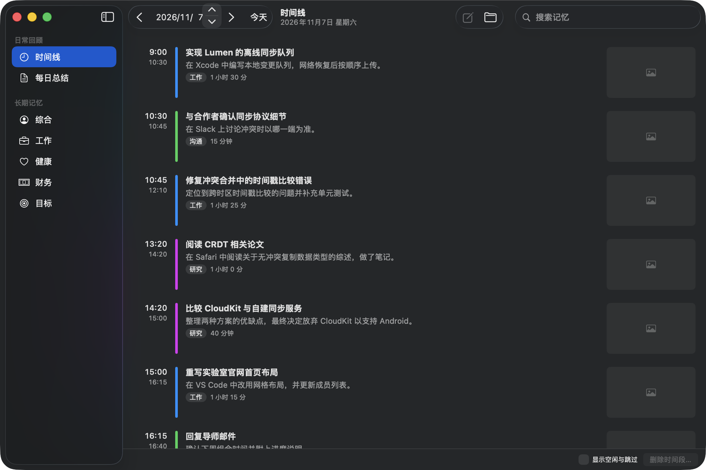
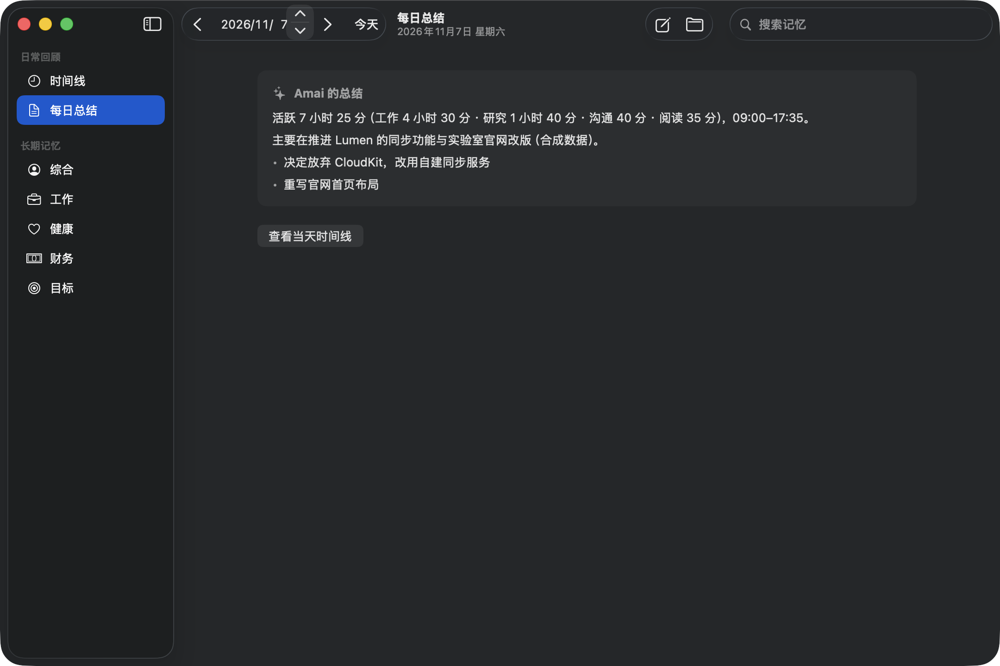
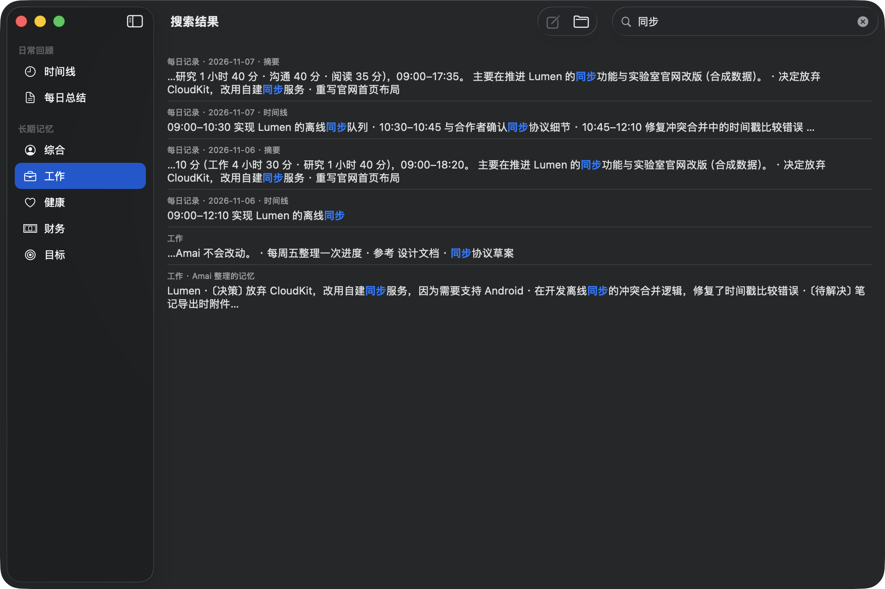
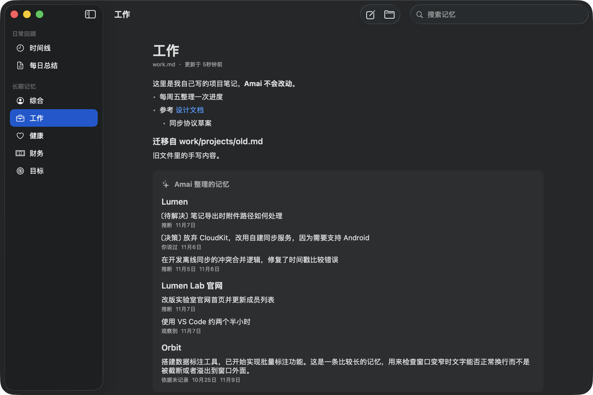
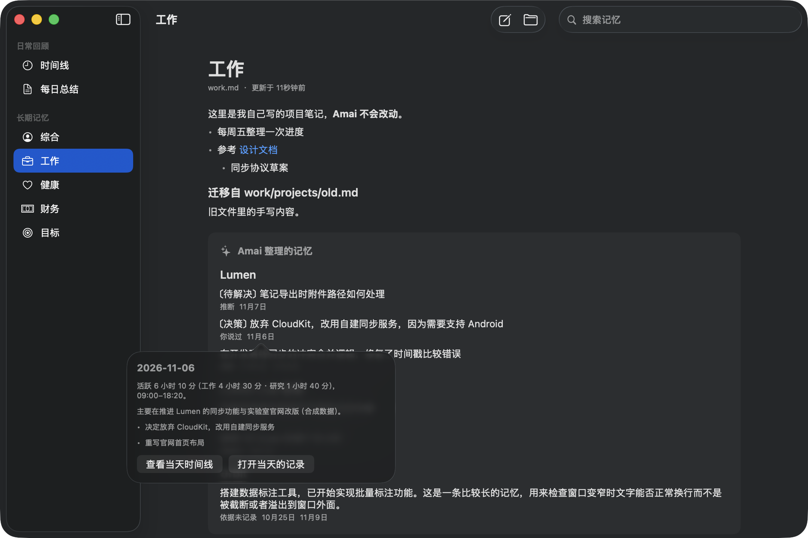
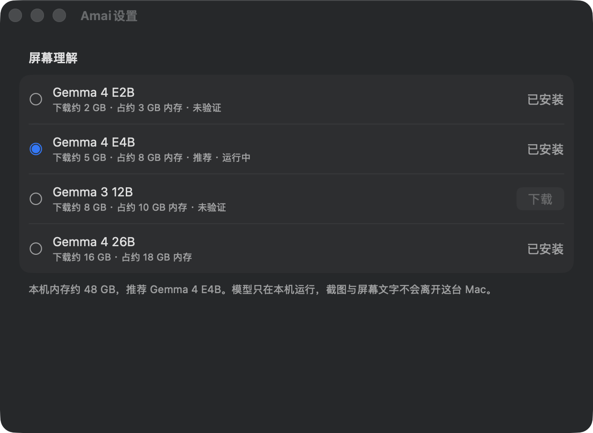
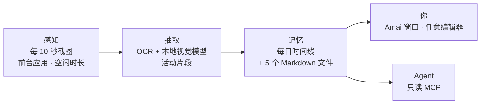

<div align="center">

# Amai

**macOS 上的 Ambient Personal AI**

Amai 在后台记下你在 Mac 上做的事，整理成每日时间线和长期记忆：<br>
纯 Markdown，保存在本机，你的 AI Agent 也能读取。

[](https://github.com/Penrose0v0/Amai/releases/latest)
[](#系统要求)
[](#系统要求)
[](Package.swift)
[](docs/mcp.md)
[](LICENSE)

[English](README.md) · **简体中文**

```bash
brew install --cask Penrose0v0/tap/amai
```



<sub>截图使用 <a href="samples/">samples/</a> 中的合成示例数据，并非真实用户的活动。</sub>

</div>

---

## 为什么是 Amai

大多数 AI 助手只知道你输入给它的内容。Amai 在后台替你积累这些上下文，并且只保存在你自己手里。

| | |
|---|---|
| 🌙 **环境式** | 不用写日记，也不用回答提问。Amai 看着屏幕，自己写时间线。 |
| 🔒 **本地优先** | 截图由运行在你 Mac 上的视觉模型理解，不会离开这台电脑。 |
| 📝 **纯 Markdown** | 记忆以文件形式存放在 `~/.amai/memory`，可以用任何工具打开、编辑和备份。 |
| 🔍 **可追溯** | 每条记忆都记录依据：你说过的、观察到的，还是推断的。 |
| 🤖 **面向 Agent** | 只读的 MCP Server 让 Claude Desktop、Claude Code 等 Agent 在你允许的范围内检索记忆。 |

## 功能

以下是 **v0.1.0** 已有的功能。

### 时间线与每日总结

每段约 15 分钟的屏幕活动会变成一条或几条时间线记录，带标题、摘要、类别和时长。每天凌晨，Amai 为前一天写一段简短总结。两者都写进 `daily/YYYY-MM-DD.md`。

<table>
  <tr>
    <td width="50%"></td>
    <td width="50%"></td>
  </tr>
  <tr>
    <td align="center"><sub>每日总结</sub></td>
    <td align="center"><sub>同时搜索时间线和记忆</sub></td>
  </tr>
</table>

### 长期记忆

Amai 根据每天的记录更新五个记忆分区：**综合**、**工作**、**健康**、**财务**、**目标**，每个分区是一个 Markdown 文件。

- Amai 只写入它自己标记的区块。你在文件中写的内容永远不会被改动。
- 每条记忆标明依据（你说过、你确认过、观察到、推断）和来源日期，点击日期可以跳到当天的时间线。
- 被替换或撤下的条目进入变更记录，每次改写前都会保存快照。
- 在其他编辑器里修改文件，几秒内就会在 App 中刷新。

<table>
  <tr>
    <td width="50%"></td>
    <td width="50%"></td>
  </tr>
  <tr>
    <td align="center"><sub>工作记忆，按项目分组</sub></td>
    <td align="center"><sub>每条记忆都能追溯到来源日期</sub></td>
  </tr>
</table>

### 本地模型

屏幕理解始终在本机运行，使用基于 [MLX](https://github.com/ml-explore/mlx-swift) 的 Gemma 视觉模型。在设置中选择并下载模型。由于 Amai 全天运行，它推荐的是内存占用不超过本机三分之一的最大已验证模型。

| 模型 | 下载 | 内存 | 状态 |
|---|---|---|---|
| Gemma 4 E4B | 约 5 GB | 约 8 GB | 默认 · 已验证 · 24 GB 内存起推荐 |
| Gemma 4 26B | 约 16 GB | 约 18 GB | 已验证 · 64 GB 内存起推荐 |
| Gemma 4 E2B | 约 2 GB | 约 3 GB | 未验证 · 内存较小的 Mac 上建议使用 |
| Gemma 3 12B | 约 8 GB | 约 10 GB | 未验证 |

<p align="center"></p>

整理长期记忆用哪个模型，在首次使用引导中由你选择：本地模型、你自己的 Anthropic 或 OpenAI API Key、ChatGPT 订阅（官方 *Sign in with ChatGPT*），或通过本机已登录的 Claude Code 使用 Claude 订阅。选择云端时只发送记忆文本，从不发送截图。

### 其他

- **首次使用引导**：设置语言，说明会记录什么，申请屏幕录制权限，选择模型。完成引导之前不会记录任何内容。
- **菜单栏应用**：随时暂停或继续记录，图标始终显示当前状态。
- **多显示器**：所有显示器都会采集，焦点所在的屏幕权重最高。
- **三种界面语言**（简体中文、English、日本語），与记忆的书写语言分开设置。

## 工作原理



1. **感知**：每 10 秒（使用电池时间隔更长）截取所有显示器，并记录前台应用和空闲时长。截图以紧凑的 HEVC 视频存入短期缓冲。
2. **抽取**：用 Apple Vision OCR 和本地视觉模型读取每一帧，把"看到的"和"推断的"分开记录，再把这些帧归并成活动。
3. **记忆**：把活动写进当天的 daily 文件。凌晨 4 点左右总结前一天并更新各长期记忆分区，综合分区每周更新一次。

更多细节：[架构](docs/architecture.md) · [记忆系统](docs/memory.md)。

## 隐私

Amai 能看到你的屏幕，因此隐私是设计的一部分，而不是事后加上的一个开关。

- **截图不离开你的 Mac**：视觉模型在本机运行，下载模型时只连接 Hugging Face。
- **原始截图只短期保留**：最多保留 72 小时或 2 GB，先到者为准，之后删除。
- **敏感时刻自动跳过**：在密码框中输入时，或密码管理器（1Password、Bitwarden、KeePassXC、钥匙串访问）在前台时，不截图。无法确认排除规则已生效时，直接丢弃这一帧。
- **从不记录按键内容**：只记录应用切换和空闲时长。
- **凭据脱敏**：OCR 文本落盘前先脱敏。日志只记录计数和耗时，不记录屏幕内容。
- **云端需主动开启**：只有你选择云端来源时，记忆整理才会发往云端，且只发送记忆文本。
- **一切可查看、可删除**：可以在时间线中删除任意时间段，编辑或删除任何 Markdown 文件，也可以在菜单栏随时暂停。

## 接入 AI Agent（MCP）

App 内附带只读 MCP Server `amai-mcp`，**默认关闭**。启用后提供三个工具：

| 工具 | 返回内容 |
|---|---|
| `search_memory` | 匹配的记忆条目，含分区、日期和依据类型 |
| `get_timeline` | 某一天的活动和每日总结（`today`、`yesterday` 或具体日期） |
| `get_memory` | 某个记忆分区，可只取一个小节或项目 |

在 `~/Library/Application Support/Amai/config.json` 中启用，并选择 Agent 可以读取的分区。默认只开放 `general`、`work`、`goals`；`daily`、`health`、`finance` 要你手动加入才会开放。

```json
"mcp": { "enabled": true, "categories": ["general", "work", "goals"] }
```

然后添加到你的 Agent：

```bash
# Claude Code
claude mcp add amai -- /Applications/Amai.app/Contents/MacOS/amai-mcp
```

```jsonc
// Claude Desktop：~/Library/Application Support/Claude/claude_desktop_config.json
{ "mcpServers": { "amai": { "command": "/Applications/Amai.app/Contents/MacOS/amai-mcp" } } }
```

这个 Server 从不写入记忆，也不发起网络请求。但 Agent 读到的内容会发送给它所用的模型服务，所以只开放你愿意分享的分区。完整说明：[docs/mcp.md](docs/mcp.md)。

## 使用场景

- **"我这周到底做了什么？"**：看时间线和每日总结，不用凭记忆回想。
- **接着上次的进度继续**：项目记忆保存了决策、待解决的问题和进展，每条都能追溯到来源日期。
- **给 Agent 真实的上下文**：让 Claude 回答前先查一下你当前的项目和目标，不用手动粘贴。
- **掌握自己的历史**：一切都是你磁盘上的 Markdown，可以 grep、做版本管理，用你喜欢的方式同步。

## 安装

### Homebrew（推荐）

```bash
brew install --cask Penrose0v0/tap/amai
```

### 手动下载

从 [GitHub Releases](https://github.com/Penrose0v0/Amai/releases/latest) 下载 `Amai-<版本号>.zip`，解压后把 `Amai.app` 移到 `/Applications`，再执行：

```bash
xattr -dr com.apple.quarantine /Applications/Amai.app
```

Amai 已签名但**尚未公证**。Homebrew cask 会自动去掉隔离属性；手动下载需要执行上面的命令。

### 系统要求

- Apple Silicon Mac，macOS 15 Sequoia 或更新版本
- 默认模型（Gemma 4 E4B）建议 24 GB 以上内存；内存较小的 Mac 可以使用 Gemma 4 E2B
- 磁盘空间：模型约 5 GB（Gemma 4 E4B，首次使用时下载），另需最多 2 GB 的短期截图缓冲

### 首次使用

Amai 常驻菜单栏。首次打开会进入引导：申请屏幕录制权限，选择并下载模型。在最后一步点击**开始记录**后才会开始记录。

### 你的数据

| 位置 | 内容 |
|---|---|
| `~/.amai/memory/` | 你的记忆（Markdown），位置可修改 |
| `~/Library/Application Support/Amai/` | 设置、短期截图缓冲、抽取结果、快照 |

`brew uninstall --cask amai` 会删除 App。你的记忆文件永远不会被删除，`brew uninstall --zap` 也不会。

## 状态与路线图

Amai 目前是 **v0.1.0**，作者本人每天都在使用的早期版本，难免有不完善之处。

**已知限制**

- 尚未公证。
- 如果 Amai 在记录过程中退出，最后几秒的屏幕录像可能丢失。
- 本地模型整理出的记忆质量低于大型云端模型，在健康和财务分区尤其明显。详见[评测记录](docs/roadmap.md)。

**计划中（v0.1.0 未包含）**

- 系统音频和麦克风转录
- 在设置窗口中开关 MCP、选择开放分区
- 公证
- 语义（embedding）检索，以及基于记忆的对话问答

详细进度见 [docs/roadmap.md](docs/roadmap.md)。

## 开发

需要 macOS 15+、Xcode 26（含 Metal 工具链组件）和 Swift 6。

```bash
swift build                  # 编译
swift test                   # 运行不依赖 MLX 模型权重的测试
./scripts/bundle.sh          # 组装 .build/Amai.app（含 mlx.metallib，已签名）
open .build/Amai.app         # 运行（菜单栏应用）
./scripts/memory-preview.sh  # 只用合成示例数据打开主窗口
```

`swift run` 无法运行 MLX 推理，因为 SwiftPM 不编译 Metal kernel，请使用 `bundle.sh`。

如果本机有 "Apple Development" 证书，`bundle.sh` 会用它签名，这样屏幕录制和钥匙串授权在重新打包后依然有效。没有这类证书时，改用 `./scripts/setup-dev-cert.sh` 创建的自签名证书 `Amai Local Dev`。也可以用 `AMAI_SIGN_IDENTITY` 指定签名身份。发布打包流程见 [docs/release.md](docs/release.md)。

### 架构

Amai 是一个 Swift package，分为职责严格分开的三层：**感知 → 抽取 → 记忆**。

```text
Sources/
├── AmaiCore/         数据契约（PerceptionEvent、Observation、ActivitySegment、MemoryEntry）、时钟、日志
├── AmaiPerception/   屏幕与交互采集、权限、原始缓冲、隐私策略
├── AmaiExtraction/   OCR、本地模型（mlx-swift-lm）、分批、活动切分
├── AmaiMemory/       Markdown 存储、整理、索引（GRDB / SQLite FTS5）、只读 Memory API
├── AmaiMemoryUI/     时间线与记忆浏览界面
├── AmaiCloud/        记忆整理可选的云端与订阅客户端
├── AmaiMCP/          基于 Memory API 的 MCP 工具
├── AmaiMCPServer/    amai-mcp 可执行文件（stdio）
├── AmaiMemoryCLI/    开发用命令行 amai-memory
└── Amai/             菜单栏应用、设置、首次使用引导与各层装配
```

| 文档 | 内容 |
|---|---|
| [docs/product.md](docs/product.md) | 产品定义与范围 |
| [docs/architecture.md](docs/architecture.md) | 分层、模块与数据契约 |
| [docs/memory.md](docs/memory.md) | Markdown 记忆格式与整理机制 |
| [docs/mcp.md](docs/mcp.md) | MCP Server 配置 |
| [docs/release.md](docs/release.md) | 打包与分发 |
| [docs/decisions/](docs/decisions/) | 架构决策记录 |
| [AGENTS.md](AGENTS.md) | 面向贡献者和 Coding Agent 的工程规范 |

## 致谢

Amai 的设计受到了 [Dayflow](https://github.com/JerryZLiu/Dayflow)、[Screenpipe](https://github.com/mediar-ai/screenpipe)、[OpenClaw](https://github.com/openclaw/openclaw) 和 [Hermes Agent](https://github.com/NousResearch/hermes-agent) 等开源项目的启发。

感谢这些项目及其贡献者对开源生态的支持。

## 许可证

[MIT](LICENSE)
