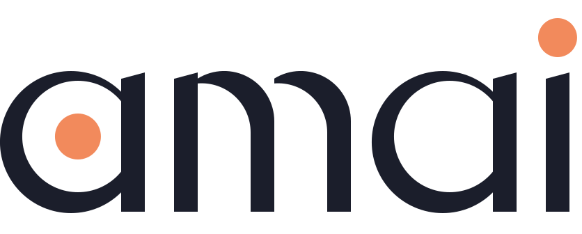
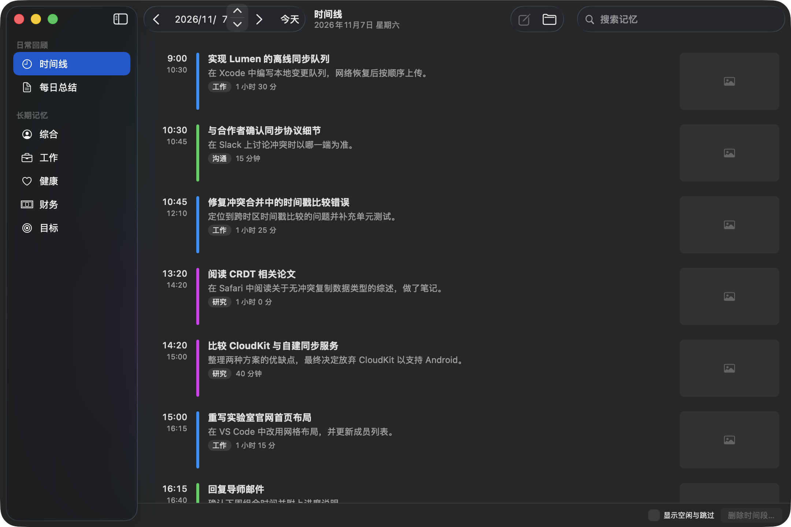
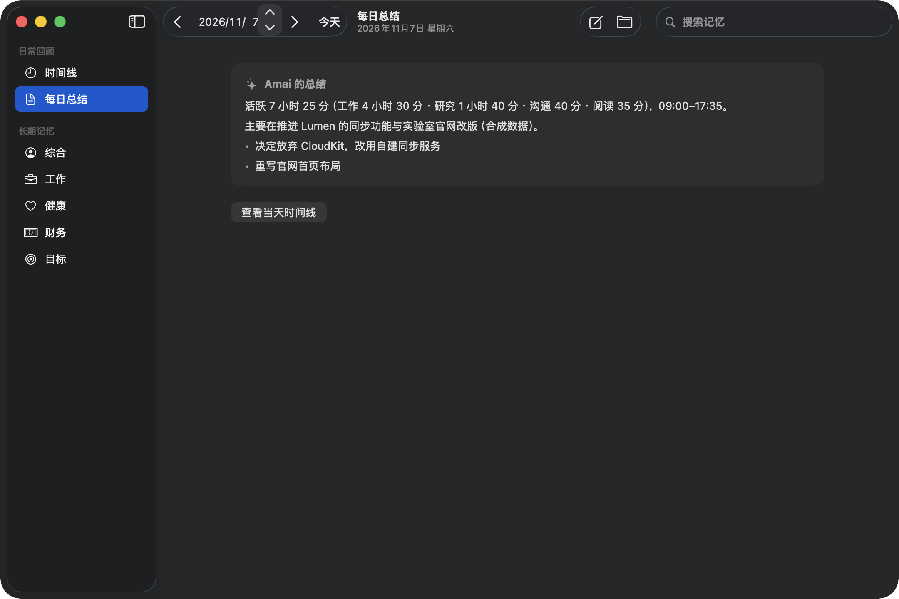
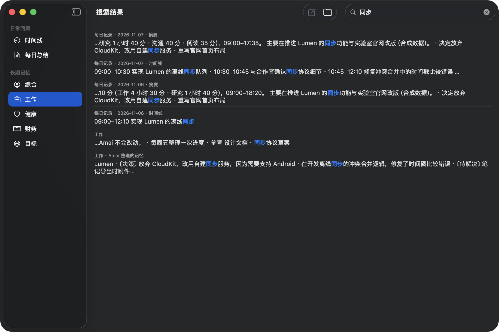
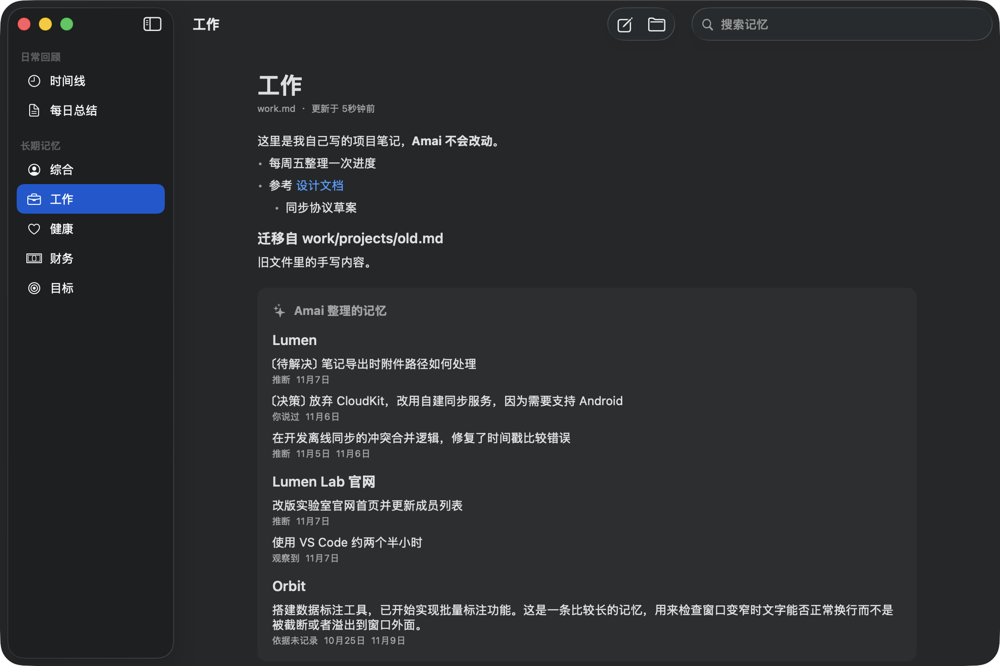
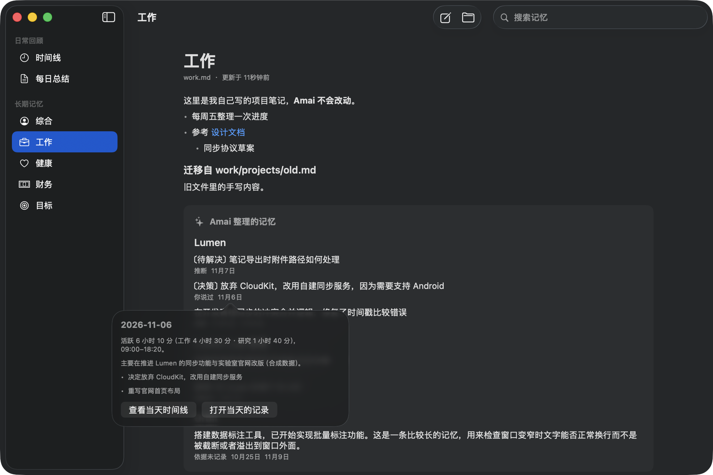
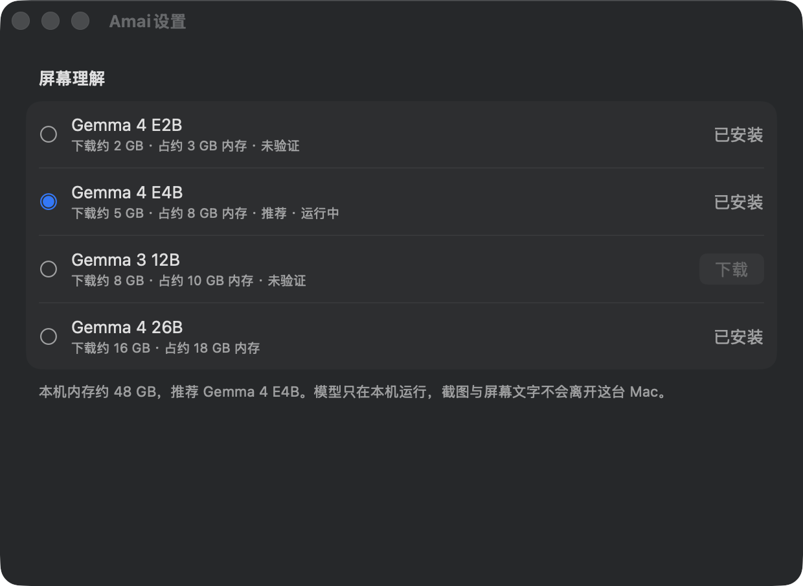
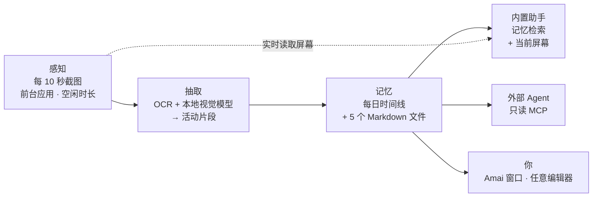

<div align="center">

<h1>
  <picture>
    <source media="(prefers-color-scheme: dark)" srcset="docs/assets/amai-wordmark-dark.svg">
    
  </picture>
</h1>

**Ambient Personal AI**

每次用 AI，都要先把自己的情况再解释一遍。<br>
Amai 在后台持续理解你的日常活动，积累属于你的个人上下文，<br>
供内置助手和你常用的其他 AI Agent 使用。本地优先，开源，隐私由你掌控。

[](https://github.com/Penrose0v0/Amai/releases/latest)
[](#系统要求)
[](#系统要求)
[](Package.swift)
[](docs/mcp.md)
[](LICENSE)

[English](README.md) · **简体中文** · [日本語](README.ja.md)

https://github.com/user-attachments/assets/42379ed5-3f69-4cca-ab0e-18166f47e6ea

<sub>视频和截图使用 <a href="samples/">samples/</a> 中的合成示例数据，并非真实用户的活动。</sub>

</div>

---

## 快速开始

```bash
brew install --cask Penrose0v0/tap/amai
```

也可以从 [GitHub Releases](https://github.com/Penrose0v0/Amai/releases/latest) 下载 zip。需要 Apple Silicon Mac 和 macOS 15 或更新版本，详见[安装](#安装)。

## 为什么是 Amai

大多数 AI 助手只知道你输入给它的内容。每开一个新对话、每换一个工具，都要把同一段话再说一遍：你在做什么，上周定了什么，现在屏幕上是什么。

Amai 是一个 Ambient Personal AI，替你积累这些上下文。它跟上你在做的事，整理成时间线和长期记忆，并在你需要的地方用上这些记忆：它自己的助手里，以及你已经在用的 Agent 里。

| | |
|---|---|
| 🌙 **环境式** | 不用写日记，也不用回答提问。Amai 看着屏幕，自己写时间线。 |
| 🧠 **持续的上下文** | 每天的活动沉淀为长期记忆：你的项目、决策、习惯和目标。上下文可以一天天延续下去。 |
| 💬 **内置助手** | 按一个快捷键打开对话。它已经知道你屏幕上是什么，能根据你的记忆回答，并给出来源。 |
| 🤖 **面向 Agent** | 只读的 MCP Server 让 Claude Desktop、Claude Code 等 Agent 在你允许的范围内检索记忆。 |
| 🔒 **本地优先** | 后台采集的画面由运行在你本机的视觉模型理解。云端模型是可选的，能读到什么由你决定。 |
| 📝 **纯 Markdown** | 记忆以文件形式存放在 `~/.amai/memory`，可以用任何工具打开、编辑和备份。 |
| 🔍 **可追溯** | 每条记忆都记录来源日期，可以回到当天看看你在做什么。 |

## 功能

以下是当前发布版本 **v0.2.1** 已有的功能。

### 时间线与每日总结

每段约 15 分钟的屏幕活动会变成一条或几条时间线记录，带标题、摘要、类别和时长。每天凌晨，Amai 为前一天写一段简短总结。两者都写进 `daily/YYYY-MM-DD.md`。

<p align="center"></p>

<table>
  <tr>
    <td width="50%"></td>
    <td width="50%"></td>
  </tr>
  <tr>
    <td align="center"><sub>每日总结</sub></td>
    <td align="center"><sub>同时搜索时间线和记忆</sub></td>
  </tr>
</table>

### 长期记忆

Amai 根据每天的记录更新五个记忆分区：**综合**、**工作**、**健康**、**财务**、**目标**，每个分区是一个 Markdown 文件。

- Amai 只写入它自己标记的区块。你在文件中写的内容永远不会被改动。
- 每条记忆标明来源日期，点击日期可以跳到当天的时间线。
- 被替换或撤下的条目进入变更记录，每次改写前都会保存快照。
- 在其他编辑器里修改文件，几秒内就会在 App 中刷新。

<table>
  <tr>
    <td width="50%"></td>
    <td width="50%"></td>
  </tr>
  <tr>
    <td align="center"><sub>工作记忆，按项目分组</sub></td>
    <td align="center"><sub>每条记忆都能追溯到来源日期</sub></td>
  </tr>
</table>

### 内置助手

在任意应用里按 **⌘⇧Space** 打开对话面板。快捷键可以在设置中更换。

- **知道你正在看什么**：每个问题都带上当前的应用、窗口标题、选中的文字和屏幕上的文字。输入框旁的开关可以再附上一张截图。
- **根据你的记忆回答**：Amai 在调用模型之前就把相关的时间线记录和记忆条目检索好，所以较小的本地模型也能回答"我上周二在做什么"。回答下方列出用到的记忆，点击来源可以在主窗口中打开。
- **语义检索可选**：装上一个小的本地向量模型（Qwen3-Embedding-0.6B，约 330 MB）后，问法与记录的措辞不同、甚至语言不同，也能找到。没有它时退回关键词检索。
- **跨应用处理选中的文字**：在任意应用里选中文字再打开面板，翻译、润色、解释、概括会作为建议出现，一键发送；也可以带着这段文字自己提问。回答可以复制，也可以重新生成。
- **提前做好准备**：面板一打开，Amai 就开始读屏幕、预热本地模型，把你打字的时间用起来。在 M5 Pro 上用 Gemma 4 E4B 实测，提交后约 0.2 秒出现第一个字；不做这些准备时约 2 秒。
- **模型由你选择**：没有默认值。可以用本地模型、你自己的 API Key（Anthropic，或任何 OpenAI 兼容接口）、ChatGPT 订阅或 Claude 订阅。选定之前助手不可用。助手能读哪些记忆分区也由你决定，健康和财务默认不开放。
- **只读**：助手不修改你的记忆，也不替你操作其他应用。对话记录保存在本机，可以在设置中删除。

### 本地模型

屏幕理解始终在本机运行，使用基于 [MLX](https://github.com/ml-explore/mlx-swift) 的 Gemma 视觉模型。在设置中选择并下载模型。由于 Amai 全天运行，它推荐的是内存占用不超过本机三分之一的最大已验证模型。

| 模型 | 下载 | 内存 | 状态 |
|---|---|---|---|
| Gemma 4 E4B | 约 5 GB | 约 8 GB | 默认 · 已验证 · 24 GB 内存起推荐 |
| Gemma 4 26B | 约 16 GB | 约 18 GB | 已验证 · 64 GB 内存起推荐 |
| Gemma 4 E2B | 约 2 GB | 约 3 GB | 未验证 · 内存较小的电脑上建议使用 |
| Gemma 3 12B | 约 8 GB | 约 10 GB | 未验证 |

<p align="center"></p>

整理长期记忆用哪个模型，在首次使用引导中由你选择：本地模型、你自己的 Anthropic 或 OpenAI API Key、ChatGPT 订阅（官方 *Sign in with ChatGPT*），或通过本机已登录的 Claude Code 使用 Claude 订阅。记忆整理选择云端时只发送记忆文本，从不发送截图。

助手用的模型单独选择，可选的本地模型和云端来源与上面相同。如果它和屏幕理解用的是同一个本地模型，两者在内存中共用一份。助手的本地模型在 Amai 运行期间一直保持加载，这样面板一打开就能响应，所以它占用的内存要按常驻来算。

### 其他

- **首次使用引导**：设置语言，说明会记录什么，申请屏幕录制权限，选择模型，设置助手（可以跳过）。完成引导之前不会记录任何内容。
- **菜单栏应用**：随时暂停或继续记录，图标始终显示当前状态；有新版本时图标变蓝。通过 Homebrew 安装时，点菜单中的**更新到 vX** 即可升级并自动重新打开。
- **多显示器**：所有显示器都会采集，焦点所在的屏幕权重最高。
- **三种界面语言**（简体中文、English、日本語），与记忆的书写语言分开设置。

## 工作原理



1. **感知**：每 10 秒（使用电池时间隔更长）截取所有显示器，并记录前台应用和空闲时长。截图以紧凑的 HEVC 视频存入短期缓冲。
2. **抽取**：用 Apple Vision OCR 和本地视觉模型读取每一帧，把"看到的"和"推断的"分开记录，再把这些帧归并成活动。
3. **记忆**：把活动写进当天的 daily 文件。凌晨 4 点左右总结前一天并更新各长期记忆分区，综合分区每周更新一次。
4. **内置助手**：按固定的一趟流程回答：读取当前屏幕，检索记忆（问题提到某一天时取当天的时间线，再加上关键词检索和可选的语义检索），然后调用模型一次。它只读记忆，走的是和 MCP 相同的只读 Memory API。
5. **外部 Agent**：通过只读的 MCP Server 读取同一份记忆，范围限于你开放的分区。

更多细节：[架构](docs/architecture.md) · [记忆系统](docs/memory.md)。

## 隐私

Amai 能看到你的屏幕，因此隐私是设计的一部分，而不是事后加上的一个开关。

- **后台采集的内容不离开你的电脑**：视觉模型在本机运行，后台截图从不上传。Amai 自己发起的联网只有两处：从 Hugging Face 下载模型，以及每 6 小时到 GitHub 检查一次新版本（不发送任何个人数据）。
- **原始截图只短期保留**：最多保留 72 小时或 2 GB，先到者为准，之后删除。
- **敏感时刻自动跳过**：在密码框中输入时，或密码管理器（1Password、Bitwarden、KeePassXC、钥匙串访问）在前台时，不截图。无法确认排除规则已生效时，直接丢弃这一帧。
- **从不记录按键内容**：只记录应用切换和空闲时长。
- **凭据脱敏**：OCR 文本落盘前先脱敏。日志只记录计数和耗时，不记录屏幕内容。
- **云端需主动开启**：只有你选择云端来源时，记忆整理才会发往云端，且只发送记忆文本。
- **云端助手只发送对话需要的内容**：如果你为助手选了云端模型，Amai 会列出将要发送的内容并请你确认一次：你的提问与对话、选中的文字、当前应用的名称与屏幕文字、你附上截图时的那张截图，以及从你允许的分区里检索到的记忆。只在你使用助手时发送。使用本地模型时，这些内容都不离开你的电脑。
- **助手只在你打开它时读取屏幕**：它遵守与后台采集相同的排除规则，密码框或被排除的应用在前台时拒绝读取。读取选中的文字需要可选的辅助功能权限，并且只在那一刻读取；Amai 不监听键盘，也不监视你的选区。
- **一切可查看、可删除**：可以在时间线中删除任意时间段，编辑或删除任何 Markdown 文件，在设置中删除助手的对话记录，也可以在菜单栏随时暂停。

## 接入 AI Agent（MCP）

App 内附带只读 MCP Server `amai-mcp`，**默认关闭**。启用后提供三个工具：

| 工具 | 返回内容 |
|---|---|
| `search_memory` | 匹配的记忆条目，含分区、日期和来源日期 |
| `get_timeline` | 某一天的活动和每日总结（`today`、`yesterday` 或具体日期） |
| `get_memory` | 某个记忆分区，可只取一个小节或项目 |

在 `~/Library/Application Support/Amai/config.json` 中启用，并选择 Agent 可以读取的分区。默认只开放 `general`、`work`、`goals`；`daily`、`health`、`finance` 要你手动加入才会开放。

```json
"mcp": { "enabled": true, "categories": ["general", "work", "goals"] }
```

然后添加到你的 Agent：

```bash
# Claude Code
claude mcp add amai -- /Applications/Amai.app/Contents/MacOS/amai-mcp
```

```jsonc
// Claude Desktop：~/Library/Application Support/Claude/claude_desktop_config.json
{ "mcpServers": { "amai": { "command": "/Applications/Amai.app/Contents/MacOS/amai-mcp" } } }
```

这个 Server 从不写入记忆，也不发起网络请求。但 Agent 读到的内容会发送给它所用的模型服务，所以只开放你愿意分享的分区。完整说明：[docs/mcp.md](docs/mcp.md)。

## 使用场景

- **"我这周到底做了什么？"**：看时间线和每日总结，或者直接问助手，不用凭记忆回想。
- **接着上次的进度继续**：项目记忆保存了决策、待解决的问题和进展，每条都能追溯到来源日期。
- **提问不用先交代背景**：在手头的工作上直接打开助手。屏幕、选区和你的记忆，它都已经拿到了。
- **就地处理文字**：在任意应用里选中一段话，翻译、润色、解释或概括，不用切换窗口。
- **给 Agent 真实的上下文**：让 Claude 回答前先查一下你当前的项目和目标，不用手动粘贴。
- **掌握自己的历史**：一切都是你磁盘上的 Markdown，可以 grep、做版本管理，用你喜欢的方式同步。

## 安装

### Homebrew（推荐）

```bash
brew install --cask Penrose0v0/tap/amai
```

### 手动下载

从 [GitHub Releases](https://github.com/Penrose0v0/Amai/releases/latest) 下载 `Amai-<版本号>.zip`，解压后把 `Amai.app` 移到 `/Applications`，再执行：

```bash
xattr -dr com.apple.quarantine /Applications/Amai.app
```

Amai 已签名但**尚未公证**。Homebrew cask 会自动去掉隔离属性；手动下载需要执行上面的命令。

### 系统要求

- Apple Silicon Mac，macOS 15 Sequoia 或更新版本
- 默认模型（Gemma 4 E4B）建议 24 GB 以上内存；内存较小时可以使用 Gemma 4 E2B
- 磁盘空间：模型约 5 GB（Gemma 4 E4B，首次使用时下载），另需最多 2 GB 的短期截图缓冲
- 助手使用本地模型时：在上述基础上还需要该模型的内存，除非它与屏幕理解用的是同一个模型

### 首次使用

Amai 常驻菜单栏。首次打开会进入引导：申请屏幕录制权限，选择并下载模型。在最后一步点击**开始记录**后才会开始记录。助手可以在引导中一并设置，也可以之后在设置里设置；辅助功能权限是可选的，只用于读取选中的文字。

### 你的数据

| 位置 | 内容 |
|---|---|
| `~/.amai/memory/` | 你的记忆（Markdown），位置可修改 |
| `~/Library/Application Support/Amai/` | 设置、短期截图缓冲、抽取结果、快照、检索索引、助手的对话记录 |

`brew uninstall --cask amai` 会删除 App。你的记忆文件永远不会被删除，`brew uninstall --zap` 也不会。

## 状态与路线图

Amai 目前是 **v0.2.1**，作者本人每天都在使用的早期版本，难免有不完善之处。当前发布版本运行在 Apple Silicon Mac 上。

**已发布**

- **v0.1.0**：屏幕采集、时间线与每日总结、Markdown 长期记忆、本地模型、记忆整理的云端与订阅来源、只读 MCP Server、首次使用引导、三种界面语言。
- **v0.2.0**：内置助手（对话面板、带来源的记忆问答、关键词与语义检索、跨应用选中文字的建议操作），Homebrew 安装的应用内更新，新的 Logo 与图标。
- **v0.2.1**：修复界面语言切换的问题。

**已实现，尚未发布**

- 助手的记忆检索改为按 token 预算（默认 4K）选取，不再固定取前 6 条，需要多条证据的问题能拿到更多依据。能认出更多日期写法（"3 天前"、英文月份、英文和日文的星期）。
- 对话面板关闭超过三分钟后再打开，会开始一段新对话；之前的对话仍在历史里。
- 一个开发用的评测工具，可以在自己的记忆上评测记忆问答与检索（`amai-memory qa-eval`，见 [docs/qa-eval.md](docs/qa-eval.md)）。

**已知限制**

- 尚未公证。
- 如果 Amai 在记录过程中退出，最后几秒的屏幕录像可能丢失。
- 本地模型整理出的记忆质量低于大型云端模型，在健康和财务分区尤其明显。详见[评测记录](docs/roadmap.md)。
- 助手的回答质量取决于检索和所用的模型。作者在 v0.2 上做的第一次评测（31 天的真实记忆，100 道题，本地运行的 Gemma 4 26B）中，总体正确率 61%：可回答的题答对 55%，无法回答的题有 93% 被正确拒答。上面提到的检索改动针对的是主要原因，但还没有在人工标注的题目上重新评分。
- 助手的云端来源测试得不如本地模型充分。
- 不是每个应用里的选中文字都能读到（例如表格的单元格），公式显示为 LaTeX 原文，快捷键只能在几个预设组合里选。
- MCP 需要编辑配置文件来开启。

**计划中**

- 系统音频和麦克风转录
- 在设置窗口中开关 MCP、选择开放分区
- 公证
- 长时间运行的稳定性与资源占用测量

**探索中，不作承诺**

- 其他平台。仓库中有一份 iOS 屏幕采集的调研和概念验证，尚未在真机上测量。
- 在助手之上增加 Agent 能力。目前它只回答问题，不执行操作，也不写入记忆。

详细进度见 [docs/roadmap.md](docs/roadmap.md)。

## 开发

需要 macOS 15+、Xcode 26（含 Metal 工具链组件）和 Swift 6。

```bash
swift build                  # 编译
swift test                   # 运行不依赖 MLX 模型权重的测试
./scripts/bundle.sh          # 组装 .build/Amai.app（含 mlx.metallib，已签名）
open .build/Amai.app         # 运行（菜单栏应用）
./scripts/memory-preview.sh  # 只用合成示例数据打开主窗口
```

`swift run` 无法运行 MLX 推理，因为 SwiftPM 不编译 Metal kernel，请使用 `bundle.sh`。

如果本机有 "Apple Development" 证书，`bundle.sh` 会用它签名，这样屏幕录制和钥匙串授权在重新打包后依然有效。没有这类证书时，改用 `./scripts/setup-dev-cert.sh` 创建的自签名证书 `Amai Local Dev`。也可以用 `AMAI_SIGN_IDENTITY` 指定签名身份。发布打包流程见 [docs/release.md](docs/release.md)。

### 架构

Amai 是一个 Swift package，分为职责严格分开的三层：**感知 → 抽取 → 记忆**。内置助手和 MCP Server 在这条流水线旁边，只读取记忆。

```text
Sources/
├── AmaiCore/          数据契约（PerceptionEvent、Observation、ActivitySegment、MemoryEntry、ChatModel）、时钟、日志
├── AmaiPerception/    屏幕与交互采集、权限、原始缓冲、隐私策略、交互式屏幕读取、OCR
├── AmaiInference/     本地模型运行时（mlx-swift-lm）：加载、权重共享、调度、对话缓存、向量模型
├── AmaiExtraction/    帧筛选、观察抽取、分批、活动切分
├── AmaiMemory/        Markdown 存储、整理、索引（GRDB / SQLite FTS5 + 向量）、只读 Memory API
├── AmaiMemoryUI/      时间线与记忆浏览界面
├── AmaiCloud/         记忆整理与助手可选的云端与订阅客户端
├── AmaiAssistant/     助手（不含界面）：上下文组装、记忆检索、对话记录
├── AmaiMCP/           基于 Memory API 的 MCP 工具
├── AmaiMCPServer/     amai-mcp 可执行文件（stdio）
├── AmaiMemoryCLI/     开发用命令行 amai-memory
├── AmaiExtractionCLI/ 开发用命令行 amai-extraction
├── AmaiMemoryEval/    记忆整理评测（仅开发时使用）
├── AmaiQAEval/        记忆问答与检索评测（仅开发时使用）
└── Amai/              菜单栏应用、对话面板、设置、首次使用引导与各层装配
```

| 文档 | 内容 |
|---|---|
| [docs/product.md](docs/product.md) | 产品定义与范围 |
| [docs/architecture.md](docs/architecture.md) | 分层、模块与数据契约 |
| [docs/memory.md](docs/memory.md) | Markdown 记忆格式与整理机制 |
| [docs/mcp.md](docs/mcp.md) | MCP Server 配置 |
| [docs/qa-eval.md](docs/qa-eval.md) | 记忆问答与检索的评测 |
| [docs/release.md](docs/release.md) | 打包与分发 |
| [docs/decisions/](docs/decisions/) | 架构决策记录 |
| [AGENTS.md](AGENTS.md) | 面向贡献者和 Coding Agent 的工程规范 |

## 致谢

Amai 的设计受到了 [Dayflow](https://github.com/JerryZLiu/Dayflow)、[Screenpipe](https://github.com/mediar-ai/screenpipe)、[OpenClaw](https://github.com/openclaw/openclaw) 和 [Hermes Agent](https://github.com/NousResearch/hermes-agent) 等开源项目的启发。

感谢这些项目及其贡献者对开源生态的支持。

## 许可证

[MIT](LICENSE)
